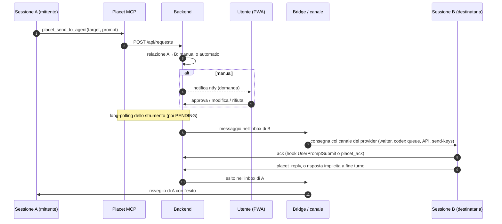

# Placet — Architettura di Sistema e Specifica Tecnica

> **Versione:** 2.1 — 16/10/2026 · **Stato:** Aggiornata dopo il laboratorio multi-provider ([LABORATORIO.md](LABORATORIO.md))
> **Ruolo:** Hub per Human-in-the-Loop, bus tra sessioni di provider diversi (Claude Code, Codex, Antigravity/Gemini) e vista delle sessioni sul telefono.

Le parti marcate *(da implementare)* sono decise ma non ancora nel codice.

---

## 1. Visione d'Insieme

```text
 ┌──────────────────────────────────────────────────────────────┐
 │ iPhone (Paolo)                                               │
 │  • Notifiche ntfy (domande; turni finiti)                    │
 │  • PWA su Tailscale: domande, sessioni, chat, progetti       │
 └──────────────────────────────▲───────────────────────────────┘
                                │ HTTPS (tailscale serve → socket Unix)
 ┌──────────────────────────────┴───────────────────────────────┐
 │ Placet Backend (FastAPI, utente di sistema `placet`)         │
 │  • SQLite: richieste, eventi, sessioni, nodi, relazioni      │
 │  • Decide chi riceve cosa e quando; long-polling; SSE        │
 │  • Non legge mai i file delle conversazioni                  │
 └───────▲──────────────────────▲──────────────────────▲────────┘
         │ REST (token agente)  │ REST (token agente)  │ REST /api/bridge/* (token bridge)
 ┌───────┴────────┐   ┌─────────┴─────────┐   ┌────────┴──────────────────────────┐
 │ Server MCP     │   │ Hook dei provider │   │ Bridge (servizio utente `paolo`)  │
 │ (stdio, uno    │   │ (eventi di turno, │   │  Adattatori per provider:         │
 │  per sessione) │   │  waiter Claude)   │   │  consegna · lettura chat ·        │
 └───────▲────────┘   └─────────▲─────────┘   │  contesto/consumi · comandi       │
         │                      │             └────────┬──────────────────────────┘
         └──────────┬───────────┘                      │ canale del provider
                    │                                  ▼
   ┌────────────────┴──────────────────────────────────────────────────┐
   │ Sessioni: Claude desktop/CLI · Codex desktop/CLI · Antigravity    │
   └───────────────────────────────────────────────────────────────────┘
```

Tre flussi:
1. **Domande e prompt** partono dalle sessioni (MCP), passano dal backend, arrivano a te (PWA) o a un'altra sessione (bridge).
2. **Eventi di turno** (inizio, fine, ultima risposta, strumenti usati) arrivano dagli hook di ogni provider: Placet sa quali sessioni esistono, se lavorano o sono ferme.
3. **Chat e consumi** li legge il bridge, a richiesta, dai file dei provider; il backend fa solo da tramite verso la PWA.

---

## 2. Componenti

### 2.1 Backend (`backend/app`)
- **Stack:** Python 3.11+, FastAPI, SQLite in WAL, Pydantic, Uvicorn.
- **Due ingressi nello stesso processo** (`serve.py`): TCP `127.0.0.1:8000` per agenti e bridge; socket Unix `/run/placet/human.sock` per la PWA via `tailscale serve`. Se uno dei due si ferma, si ferma tutto.
- **Responsabilità:** richieste e loro ciclo di vita, registro delle sessioni (dagli hook), inbox per sessione, decisione su chi riceve cosa, SSE (`request_update`, `session_update`), notifiche ntfy, sweeper di scadenze e riconsegne (ogni 30 s).
- Inoltro alla PWA delle pagine di chat lette dal bridge (§5).
- *(da implementare)* nodi, progetti, relazioni e tipi; consumi per provider.

### 2.2 Server MCP (`mcp_server`)
- Un processo stdio per sessione, configurato nel client: Claude (`.mcp.json` o `claude mcp add`), Codex (`codex mcp add`, in `~/.codex/config.toml`), Antigravity 2.0 (`~/.gemini/config/mcp_config.json`; **non** `~/.gemini/antigravity/mcp_config.json`).
- Identità da `PLACET_AGENT_ID` + `PLACET_API_TOKEN`.
- Strumenti: `placet_ask_human`, `placet_send_to_agent` (prompt o `prompt_file` Markdown), `placet_reply`, `placet_ack`, `placet_list_agents` (sessioni raggiungibili e non), `placet_check_status`.
- *(da implementare)* `send(target, type_id, prompt)` e l'elenco delle relazioni della sessione (RFC-08); attesa minima lato server per le domande all'umano (RF-09).

### 2.3 Hook dei provider (`hooks/`)
Trasformano gli eventi del client in fatti per Placet (`POST /api/sessions/{id}/events`: `start`, `prompt`, `tool`, `stop`, `end`). Non bloccano mai il client. Si installano per tutte le sessioni con `hooks/install.py`, che tocca solo le voci di Placet (RF-42). Tutte le sessioni sono presenti ma silenziose: riportano solo inizio e fine dei turni e agiscono solo quando arriva un messaggio Placet; `placet_common.active(cwd)` esclude i progetti con `.placet-off` nella cartella o in una che la contiene (RF-45).

| Provider | File | Eventi usati | Note |
|---|---|---|---|
| Claude Code (app e CLI) | `~/.claude/settings.json` (globale) | SessionStart, UserPromptSubmit, PostToolUse `mcp__placet__.*`, Stop, SessionEnd | Stop contiene `last_assistant_message`. Hook asincroni con `asyncRewake` (waiter). Nel desktop `SessionEnd` sospende la conversazione; nella CLI la chiude. Il bridge apre solo sessioni desktop inattive con posta e waiter non raggiungibile (vedi `docs/CLAUDE_WAKE.md`) |
| Codex | `~/.codex/hooks.json` | SessionStart, UserPromptSubmit, PostToolUse, Stop, SessionEnd | Stessi campi di Claude: stesso script (`claude_code.py --provider codex`). Solo sincroni ("async hooks are not supported yet"); vanno approvati una volta con `/hooks`. `SessionEnd` = conversazione scaricata dall'app: la sessione è *sospesa* (RF-29c) e il bridge accoda una volta e richiede la riapertura tramite collegamento nativo, senza dichiarare iniziato il turno |
| Antigravity 2.0 | `~/.gemini/config/hooks.json` | SessionStart, PreInvocation (la prima del turno = inizio), Stop | `antigravity.py`. JSON camelCase con `conversationId`, `transcriptPath`, `modelName`; solo sincroni, devono stampare `{}`; lo Stop non ha l'ultima risposta: la legge dal file della conversazione |

### 2.4 Bridge (`bridge/`)
- Gira come **servizio utente systemd** dell'utente proprietario delle sessioni; parla col backend solo via `/api/bridge/*` con un token che non permette di decidere né leggere richieste.
- Oggi: consegna nelle sessioni tmux (`send-keys` dopo verifica di inattività: marcatori di occupato, `idle_patterns`, schermo stabile, testo attenuato scartato, nessun input recente).
- **Adattatori per provider** (`bridge/channels.py`, `bridge/transcripts.py`). Per Codex e Antigravity il backend elenca nel lavoro del bridge le sessioni con un messaggio in attesa; il bridge lo prende (`POST /api/bridge/sessions/{id}/take`), lo accoda nell'app e lo conferma (`…/injected`), oppure lo restituisce se l'accodamento fallisce. Capacità per provider:

| Capacità | Claude | Codex | Antigravity 2.0 |
|---|---|---|---|
| Consegna / risveglio | waiter (hook asincrono) o `send-keys` | `codex queue --thread <id> --message <testo>` (binario dell'app, ≥ 0.159) | `SendUserCascadeMessage` sul language server dell'app (API interna) |
| "Subito" a metà turno | hook PostToolUse → `additionalContext` | da verificare (`turn/steer`) | hook PreInvocation → `injectSteps: [{userMessage}]` |
| Lettura chat | `~/.claude/projects/<cartella>/<id>.jsonl` | `~/.codex/sessions/AAAA/MM/GG/rollout-…-<id>.jsonl` | `~/.gemini/antigravity/brain/<id>/.system_generated/logs/transcript.jsonl` |
| Contesto | `message.usage` dell'ultima risposta | `token_count.info.last_token_usage` + `model_context_window` | da verificare (`/context`, statusline `agy`) |
| Limiti 5h / 7d | statusline di una sessione CLI di servizio (`rate_limits`) | `token_count.rate_limits` nell'ultimo rollout | statusline di una sessione `agy` di servizio (`quota.<bucket>`) |
| Compact / effort | solo CLI in tmux (`send-keys`); desktop: solo al PC | da verificare | da verificare |

### 2.5 PWA (`frontend/`)
- React + Vite, servita dal backend; Markdown con `react-markdown` + `remark-gfm` (HTML grezzo ignorato, link `javascript:` bloccati).
- **Percorsi** (hash): `#/` home, `#/storico`, `#/sessione/<id>`. I link delle notifiche `#request-N` portano alla conversazione della sessione che ha fatto la domanda, oppure alla home o allo storico.
- **Home** (`Home.jsx`): domande in corso, poi le sessioni aggiunte ordinate per attività (`activity_at`: inizio o fine dell'ultimo turno, non i controlli del waiter), con provider, stato e numero di domande. "Aggiungi / vedi tutte" (`AddSessionsDialog.jsx`): un provider alla volta, spunta = sessione seguita (`PUT /api/sessions/{id}/pin`).
- **Conversazione** (`SessionView.jsx`, `useTranscript.js`): pagine da `/api/sessions/{id}/transcript`; si apre in fondo, scorrendo in alto carica le precedenti mantenendo la posizione; a ogni cambio di turno (`session_update` via SSE) chiede solo le voci nuove (`after`). Le azioni consecutive diventano un gruppo richiudibile; le domande aperte della sessione stanno in fondo alla conversazione.
- **Storico** (`History.jsx`) con la timeline di ogni richiesta.
- **Scrivere a una sessione** (`Composer.jsx`): il messaggio parte con `POST /api/sessions/{id}/messages`; finché non è consegnato resta in fondo come "In attesa" / "In consegna" (o "Non consegnato").
- *(da implementare)*: invio "Subito", barra dei consumi, grafo ed editor dei progetti.

---

## 3. Consegna e risveglio

**Regola (RF-21):** se una sessione ha una richiesta aperta, quando arriva l'esito Placet la sveglia con il canale del suo provider. Lo stesso vale per un prompt indirizzato a lei e per un tuo messaggio dalla PWA.

### 3.1 Claude Code — waiter asincrono
1. Gli hook SessionStart e Stop lanciano `placet_waiter.py` con `async: true, asyncRewake: true`.
2. Il waiter fa long-polling su `GET /api/sessions/{id}/inbox` (240 s), con un lock per sessione.
3. Quando arriva un messaggio lo stampa su stderr ed esce con codice 2: Claude Code sveglia la sessione con quel testo (nell'app compare come "Stop hook feedback").
4. *(da implementare)* Il waiter può morire durante un'attesa (osservato): il bridge controlla `waiter_seen_at` e, se manca, la sessione risulta irraggiungibile; serve un modo per ripristinarlo (es. controllo all'hook UserPromptSubmit, o waiter gestito dal bridge).

### 3.2 Codex — `codex queue`
- Il bridge consegna con il `codex` incluso nell'app desktop (`/usr/lib/chatgpt/resources/codex`); il messaggio entra come messaggio utente e avvia un turno, visibile in tempo reale nell'app.
- La risposta: `placet_reply` dell'agente, oppure l'ultimo `task_complete.last_agent_message` del rollout (risposta implicita).
- Nessun processo in attesa per sessione.

### 3.3 Antigravity 2.0 — API del language server
- Indirizzo e token: processo `language_server` dell'app (`--csrf_token` e `--override_ide_version` nella riga di comando, porte lette da `/proc`); il server giusto è quello che restituisce la conversazione, e viene ricordato.
- `POST /exa.language_server_pb.LanguageServerService/SendUserCascadeMessage` (Connect, JSON, header `x-codeium-csrf-token`) con `cascadeId`, `items: [{text}]`, `deliveryStrategy: MESSAGE_DELIVERY_STRATEGY_WHEN_IDLE` e **`cascadeConfig`** copiata dall'ultimo `USER_INPUT` della conversazione (`GetCascadeTrajectory`). Senza `cascadeConfig` il turno fallisce.
- API non documentata: adattatore isolato, controllo di versione dell'app, ripiego su `agy` in tmux (RS-07).

### 3.4 CLI in tmux
- `send-keys` dopo la verifica di inattività (oggi).
- Le sessioni create da Placet partono con `--remote-control`, così si riprendono da app desktop, telefono e web.

### 3.5 Preambolo della consegna
- L'agente destinatario riceve solo il prompt, preceduto da `[Placet Request #N da <mittente>]`.
- Nel canale hook di Claude il preambolo chiede all'agente di riportare quello che ha ricevuto, perché l'app desktop non mostra il testo del risveglio.
- I messaggi dell'utente dalla PWA (`question_type: message`) arrivano come `[Placet Request #N dall'utente]: <testo>` con una nota: niente `placet_reply`, la risposta è il turno stesso. Nella PWA appaiono come messaggi dell'utente.
- *(da implementare)* l'origine deve essere verificabile (l'agente può controllare la richiesta con uno strumento Placet): una sessione che riceve un prompt inatteso tende, giustamente, a trattarlo come prompt injection.

### 3.6 Coda locale degli eventi *(RF-28: `hooks/spool.py`, `bridge/spool_forwarder.py`)*
- Gli hook non fanno HTTP: scrivono l'evento in `~/.cache/placet/spool/` (cartella 0700, file 0600) con scrittura atomica (temporaneo nella stessa cartella + rename) e terminano. Nessun `fsync`: si accetta di perdere un evento se manca la corrente.
- Nome del file: `<boot_id>-<contatore monotono>-<event_id>.json`; l'evento contiene `event_id`, `boot_id`, `seq`, `agent`, `provider`, `session_id`, `kind` (start, prompt, tool solo per gli strumenti Placet, stop, end), `at`, `cwd` e i dati. L'ordine è quello osservato per sessione.
- L'ultima risposta di un turno è catturata dall'hook alla fine del turno e scritta nell'evento (Antigravity: letta dal file della conversazione in quel momento, con brevi ritentativi), mai letta dopo al momento dell'inoltro.
- Il bridge (unico consumatore, con lock) sorveglia la cartella con inotify e una scansione completa all'avvio e periodica; inoltra in ordine per sessione con il token dell'agente; cancella il file solo dopo la conferma del backend, che risponde solo dopo aver salvato ed è idempotente sull'`event_id`. 429, 5xx, 401/403 ed errori di rete: ritenta con backoff. Evento malformato o rifiutato in modo definitivo: spostato in `spool/failed/` senza bloccare gli altri. Limite di spazio (50 MB: oltre, i nuovi eventi sono scartati; avviso nella PWA da fare); temporanei abbandonati da più di un'ora ripuliti. Il backend ricorda gli `event_id` applicati per 14 giorni.
- Fuori dalla coda: il waiter di Claude (long-polling) e il futuro "Subito", che legge un file locale lasciato dal bridge.

### 3.7 Consegna, esecuzione, risposta *(RF-29, RF-29b)*
- Tre aspetti indipendenti per richiesta, con le prove e i loro orari (non una catena obbligatoria: possono arrivare fuori ordine):
  - **consegna**: in attesa → in corso (tentativo con `attempt_id`) → accettata (comando riuscito) / **incerta** / fallita / annullata; il messaggio *visto* nella conversazione è una prova in più;
  - **esecuzione**: non osservata → iniziata (turno aperto da quel messaggio) → completata / interrotta;
  - **risposta**: nessuna / esplicita (`placet_reply`) / implicita (ultima risposta del turno) / **ambigua** (nel turno sono entrati anche altri messaggi).
- Il messaggio porta un identificatore osservabile (`[Placet Request #N`, più l'`attempt_id`) che il bridge cerca nel file della conversazione per riconciliare un esito incerto.
- Una richiesta alla volta per sessione, fino alla conclusione. Scadenza breve per la conferma di consegna (poi riconciliazione, non reinvio), scadenza lunga solo informativa per l'esecuzione. Un'incerta non sblocca la successiva: decide l'utente (Riprova / Annulla).
- `placet_reply` non chiude da solo la richiesta: completamento del turno e risposta sono distinti.
- Implementazione: colonne `delivery_state`, `delivery_at`, `delivery_channel` (tmux, waiter, bridge), `attempt_id`, `execution_state`, `execution_at`, `reply_state`, `turn_mixed` su `requests`; lo `status` resta il riassunto per gli agenti e lo strumento MCP.
  - Le prove: presa dal waiter o dal bridge → in corso; hook di inizio turno, `placet_ack`, risposta o messaggio trovato nella conversazione → accettata; hook di inizio turno → esecuzione iniziata; fine turno → completata; fine sessione a turno aperto → interrotta.
  - Timeout del canale (`codex queue` oltre 60 s, Antigravity senza risposta) o nessuna conferma entro 90 s per waiter e bridge → **incerta**, con notifica; solo tmux conserva i 3 tentativi automatici. Il bridge rilegge la conversazione ogni 20 s cercando `[Placet Request #N`; per ora l'`attempt_id` non è nel testo, quindi qualunque tentativo trovato conta come consegna.
  - Un altro messaggio che entra nel turno di una richiesta (prompt senza `request_id` a turno aperto) segna il turno come misto: la risposta implicita diventa **ambigua**.
  - Una richiesta alla volta: la sessione non riceve la successiva finché la precedente è in consegna (anche incerta) o consegnata con esecuzione non osservata o iniziata, anche se STALLED. **Il tempo non sblocca mai la coda** (revisione Codex 3): dopo 120 s senza inizio turno arriva l'avviso "avvio non confermato", allo STALLED "da verificare"; la coda riparte solo con la prova di fine turno o con un'azione dell'utente.
  - Azioni dell'utente su una richiesta consegnata di cui Placet non vede la fine: **Confermo che è terminata** (`marked_finished_by_user`) e **Accoda comunque il prossimo** (`queue_overridden`), entrambe `POST /api/requests/{id}/queue/release` con `reason`; nessuna inventa un esito di esecuzione. **Annulla** dopo la consegna: Placet smette di aspettare, l'agente può continuare. "Subito" (RF-35) resta l'inserimento nel turno corrente.
  - Provenienza: gli hook mandano `adapter` (`claude_code.py/2`, `antigravity.py/2`); l'esecuzione registra chi l'ha osservata (`execution_source`). Segnali alternativi (app-server Codex `turn/started`/`turn/completed`, stato del language server Antigravity) da verificare prima di usarli; testo dell'assistente, assenza di scritture o timeout non provano la fine del turno.
  - Richieste precedenti a questa versione: non trattengono nessuna coda.
  - PWA: Riprova (con conferma, perché può arrivare due volte) e Annulla sul messaggio incerto, Annulla su quello in attesa; nello storico la riga dei tre aspetti. API: `POST /api/requests/{id}/delivery/retry|cancel` (utente), `POST /api/bridge/requests/{id}/uncertain|seen` (bridge).

### 3.9 Allegati *(RF-38: `bridge/attachments.py`)*
- Ogni adattatore riconosce le immagini nel proprio formato: Claude in base64 nel messaggio dell'utente; Codex come `local_image`, un file temporaneo `/tmp/codex-clipboard-<uuid>` (sparisce al riavvio: "non più disponibile"); Antigravity in `brain/<id>/.user_uploaded/` (citate nei metadati del messaggio) e i risultati di `generate_image` in `brain/<id>/`.
- La pagina della conversazione elenca per ogni voce solo `id` e nome; l'id è il cursore della voce più la posizione (`offset:voce:n`). Per leggere un allegato il bridge rilegge quella riga con lo stesso parser: si legge solo ciò che l'adattatore ha riconosciuto lì.
- Controlli sul file: percorso reale (symlink risolti) dentro le radici dell'app per quella conversazione, file regolare dell'utente, al massimo 10 MB; contenuto JPEG, PNG o WebP verificato dai magic byte, al massimo 50 Mpx. Mai SVG o HTML. `.placet-off` verificato dal backend e dal bridge.
- **File condivisi** (`placet_share_file`): la chiamata dello strumento, registrata nella conversazione da tutti e tre i provider (Claude `tool_use mcp__placet__…`, Codex `McpToolCall`, Antigravity `call_mcp_tool` con `Arguments` JSON), è la prova; l'adattatore la mostra come voce "File condiviso". Il file si rilegge con `check_shared`: nella home, nessuna cartella nascosta nel percorso reale, niente `.placet-off`, file regolare dell'utente, immagine o PDF (`%PDF-`, max 20 MB). Lo strumento MCP fa gli stessi controlli e risponde subito all'agente. I PDF si servono `inline` nel visualizzatore del browser, senza la CSP `sandbox` delle immagini (che lo bloccherebbe).
- `GET /api/sessions/{id}/attachments/{offset:voce:n}` (solo umano) passa dal bridge come le pagine e risponde con `Cache-Control: no-store`, `nosniff` e una CSP restrittiva; nessuna copia sul backend, nessun service worker. La PWA mostra "PC non raggiungibile o file non più presente" se l'immagine non arriva.

### 3.10 "Subito" *(RF-35: `hooks/steer.py`, `bridge/steer.py`)*
- Il messaggio nasce con `mode: "now"` (`delivery_mode` della richiesta). Il bridge lo prende solo per una sessione **al lavoro** di un provider che lo supporta (`STEER_PROVIDERS`); altrimenti segue la consegna normale a fine turno. Fa eccezione alla regola "una richiesta alla volta".
- **Claude Code:** il bridge lo lascia in `~/.cache/placet/steer/<sessione>.json` (0600), un messaggio alla volta per sessione. Un hook PostToolUse su tutte le azioni, preceduto da un controllo in shell (12 ms se non c'è nulla), lo prende con un `rename` atomico e lo passa al modello come `additionalContext`; poi mette in coda l'evento `steered`, che segna la consegna accettata e l'esecuzione iniziata. Nella conversazione compare come voce `hook_additional_context`, mostrata come messaggio dell'utente.
- **Turno finito prima:** il bridge riprende il file con lo stesso `rename` e rimette il messaggio in coda (`APPROVED`), che parte a fine turno come gli altri. Inserito o rimesso in coda, mai entrambi. Se il file è stato preso ma l'evento non arriva entro 2 min, la consegna diventa incerta.
- **Antigravity:** `SendUserCascadeMessage` con `MESSAGE_DELIVERY_STRATEGY_NEXT_INVOCATION` (alla prossima chiamata al modello); se fallisce, il messaggio torna in coda.
- **Codex:** non ancora: manca la prova che l'hook PostToolUse di Codex accetti `additionalContext`, e consumare il messaggio senza prova lo perderebbe.
- A fine turno i messaggi "Subito" entrati nel turno vengono completati con la risposta implicita, segnata **ambigua** (il turno ha risposto a più messaggi).

### 3.8 Esclusione `.placet-off` *(RF-45)*
Gli hook non scrivono eventi; il bridge scarta gli eventi in coda di sessioni escluse, non legge le loro conversazioni e non consegna; le consegne in sospeso diventano annullate ("progetto escluso"); la PWA nasconde sessioni e richieste del progetto (restano nel database per l'audit).
- Il backend gira come utente `placet` e non vede la home: è il bridge che cerca `.placet-off` (nella cartella o in una che la contiene) per le cartelle delle sessioni note (`folders` in `/api/bridge/work`), al massimo ogni 15 s, e le riporta con `POST /api/bridge/folders`. Il backend segna le sessioni (`excluded_at`), annulla i messaggi non ancora consegnati e, togliendo il file, le fa ricomparire.
- Sessione esclusa: fuori da `/api/sessions` e dall'SSE, le sue richieste fuori da `/api/requests`; scrivere, leggere la conversazione o indirizzarle una richiesta → 409/422 "progetto escluso". Il bridge rifiuta comunque di leggere la conversazione di una cartella esclusa, anche prima che il backend lo sappia.
- Una richiesta già consegnata resta com'è: Placet non può fermare l'agente.

---

## 4. Ciclo di vita di una richiesta



Stati:
```text
PENDING ─decisione─► APPROVED / REJECTED          (EXPIRED alla scadenza, CANCELLED dal mittente)
APPROVED ─claim─► DELIVERING ─ack─► EXECUTING ─reply─► COMPLETED
    ▲                 │                  │  (reply esplicita o implicita a fine turno)
    └─ nessun ack ────┤ (max 3 tentativi, 90 s ciascuno)
                      │                  └─ oltre execution_timeout ─► STALLED
                      └────────────────────────────────► DELIVERY_FAILED
```

---

## 5. Lettura delle chat

```text
PWA ── GET /api/sessions/{id}/transcript?before=<offset>|after=<offset>&limit=N ──► backend
backend ── lavoro "transcript" (GET /api/bridge/jobs, long-polling) ──► bridge
bridge ── trova il file, lo legge dal fondo, filtra ──► POST /api/bridge/jobs/{id}/result ──► backend ──► PWA
```
- **Canale dei lavori** (`backend/app/bridge_jobs.py`): il bridge tiene aperto un long-polling (25 s) su `/api/bridge/jobs` in un thread suo; il backend accoda il lavoro, sveglia il bridge e aspetta il risultato fino a 8 s. Se il bridge non si è fatto vivo nell'ultimo minuto la risposta è subito 503 "Il PC non risponde"; se non risponde in tempo, 504. I lavori stanno in memoria: un lavoro perso è solo una pagina da ricaricare. Misurato: 16–46 ms per pagina.
- **Lettori** (`bridge/transcripts.py`), uno per provider, tutti su file JSON Lines. Pagina = intervallo di byte: `before` legge a ritroso a blocchi da 64 KB fino a `limit` voci, `after` legge le righe nuove. Ogni voce ha `role` (`user`, `assistant`, `action`, `placet`, `command`, `compact`, `notice`), `text`, `at`, `cursor`; le azioni hanno `tool`, `kind` (`command`, `read`, `edit`, `write`, `search`, `web`, `mcp`, `skill`, `agent`, …) e `detail`. Una riga ancora in scrittura (senza a capo) viene lasciata alla lettura successiva.
- **Sviluppo in un processo** (`run_all.py`, `PLACET_TRANSCRIPTS_LOCAL=1`): il backend legge da sé con gli stessi lettori.
- **Cursore:** posizione (byte o indice di passo) della voce più vecchia restituita; il bridge legge a ritroso a blocchi.
- **Filtro (RF-32):** messaggi dell'utente e risposte testuali; azioni come una riga; niente risultati dei tool né ragionamento. Voci di servizio scartate (Claude: `attachment`, `queue-operation`, `file-history-snapshot`, …).
- **Aggiornamento dal vivo:** l'evento `stop` di una sessione produce `session_update` via SSE; la PWA chiede solo i messaggi nuovi.
- **Sicurezza (RS-06):** il backend passa solo provider e id della sessione registrata; il bridge cerca il file nelle cartelle del provider (`~/.claude/projects/*/<id>.jsonl`, `~/.codex/sessions/**/rollout-*-<id>.jsonl`, `~/.gemini/antigravity/brain/<id>/…/transcript.jsonl`), accetta solo id `[A-Za-z0-9_-]` e rifiuta i link simbolici che portano fuori da quelle cartelle.

---

## 6. Modello Dati (SQLite)

### Esistenti
- **`requests`**: `id`, `sender_id`, `recipient_id`, `question_type`, `prompt`, `edited_prompt`, `prompt_source`, `context`, `options`, `selected_options`, `custom_text`, `status`, `priority`, `created_at`, `expires_at`, `decided_at`, `completed_at`, `updated_at`, `delivered_at`, `delivery_attempts`, `delivering_since`, `executing_since`, `sender_session_id`, `recipient_session_id`.
- **`responses`**: `request_id` (unico), `responder_id`, `content`, `implicit`, `created_at`.
- **`request_events`**: timeline per richiesta (`actor`, `event`, `details`, `at`).
- **`sessions`**: `id` (id del provider), `agent_id`, `provider`, `entrypoint`, `cwd`, `title`, `tmux_session`, `state` (idle/busy), `turn_request_id`, `started_at`, `last_seen_at`, `waiter_seen_at`, `ended_at`, `activity_at` (ultimo inizio o fine turno), `pinned_at` (aggiunta alla home).
- **`agent_states`**: stato per agente (canale tmux).

### Da aggiungere *(da implementare)*
```text
nodes              (id, nome, provider, cartella)          "sessione Placet" con nome stabile
sessions.node_id   ─► nodes.id                              la sessione reale si aggancia al nodo
sessions.transcript_path                                    dal primo hook, per il bridge
projects           (id, nome)
project_nodes      (project_id, node_id)                    un nodo in più progetti
relation_types     (id, nome, descrizione)                  la descrizione la legge l'AI
relations          (id, da_node, a_node, type_id,           globale, unica per (da, a, tipo)
                    approval: manual | automatic)
project_relations  (project_id, relation_id)
requests.relation_id ─► relations.id                        per lo storico e l'audit
```
- `context` resta per compatibilità con le richieste passate, ma non viene più richiesto (RF-05b).
- La politica di consegna (manual/automatic) è visibile all'agente (RFC-06); limiti contro i cicli per relazione e per catena, modificabili per progetto (RFC-14).

---

## 7. Configurazione Agenti: `AGENTS.md`

Frontmatter YAML con agenti, token e parametri tecnici; Markdown con le descrizioni lette dagli agenti.

```markdown
---
agents:
  claude:
    tmux_session: "agent-claude"
    token: "${PLACET_TOKEN_CLAUDE}"
    allowed_targets: ["claude", "gemini", "codex", "human"]
    idle_patterns: ['^\s*[│|]?\s*[>❯]\s*(Try ".*")?\s*[│|]?\s*$']
  codex:
    token: "${PLACET_TOKEN_CODEX}"
    allowed_targets: ["claude", "gemini", "human"]
  gemini:
    token: "${PLACET_TOKEN_GEMINI}"
    allowed_targets: ["claude", "codex", "human"]
---
# Registro Agenti Placet
...
```

- In produzione il backend legge `/etc/placet/AGENTS.md` (`PLACET_AGENTS_FILE`).
- Le **regole** `A -> B: require_approval` sono sostituite dalle relazioni gestite dalla PWA (RFC-10) *(da implementare)*.

---

## 8. Sicurezza e Accesso

1. **Isolamento di rete:** il backend non è esposto su Internet; la PWA è raggiungibile solo sulla tailnet.
2. **Agenti:** Bearer token; identità dal token, mai dal corpo. Un agente vede e annulla solo le proprie richieste e risponde solo a quelle indirizzate a lui. I token non sono mai esposti da `/api/agents`.
3. **Umano:** l'header `Tailscale-User-Login` è accettato solo sul socket Unix esposto da `tailscale serve`, e solo per gli utenti in `PLACET_ALLOWED_USERS`. Scrivere a una sessione o crearne una equivale a comandare il PC: resta riservato a questa identità (RS-05).
4. **Isolamento dei processi:** il backend gira come utente `placet` (codice in `/opt/placet` di root, configurazione in `/etc/placet`, DB in `/var/lib/placet`, socket in `/run/placet` 0700). Docker non darebbe lo stesso risultato, perché il gruppo `docker` equivale a root.
5. **Bridge:** gira come l'utente delle sessioni, con un token che permette solo di leggere il lavoro da fare e segnare consegne. È l'unico componente che legge le chat, e solo dai percorsi dei provider per sessioni registrate (RS-06).
6. **API non documentate:** isolate negli adattatori, con controllo di versione e ripiego (RS-07).
7. **Limite noto:** gli agenti condividono lo stesso utente Linux e possono leggere i token l'uno dell'altro. I token distinguono gli agenti nell'audit, non li separano.
8. **Minimo privilegio (RS-04):** gli agenti non hanno chiavi per azioni pubbliche o distruttive; propongono e attendono il placet.

### Menzioni di sessioni dalla chat PWA

Nel composer, `@` apre un selettore delle altre sessioni aperte, ricercabili per
provider, agente, progetto, titolo e ID. Si possono inserire più riferimenti nello
stesso messaggio. Ogni menzione conserva il proprio `session_id` oltre al testo
visibile; cancellando il testo della menzione il riferimento non viene inviato.
Il messaggio continua a essere diretto alla sessione corrente, non ai menzionati.

`POST /api/sessions/{id}/messages` accetta `mentions: [{session_id, token}]`.
Il backend verifica la presenza del token, la disponibilità e non esclusione della
sessione e l'assenza di autoriferimenti. I permessi di routing si verificano
sull'effettivo invio dell'agente, non sulla citazione dell'utente. I riferimenti
risolti vengono conservati nel contesto della richiesta e inclusi nell'iniezione
come dati JSON, separati dal testo con una riga vuota. Non viene aggiunto il
paragrafo operativo sull'uso di `placet_send_to_agent`: l'agente distingue dal
testo dell'utente una semplice citazione da una richiesta di collaborazione.
Una menzione non crea richieste automaticamente: è l'agente a formulare gli
incarichi, ciascuno con il normale flusso di approvazione e consegna Placet. Se il
tool non è disponibile, l'agente deve segnalarlo. La selezione non garantisce che
il modello esegua la delega: la conferma effettiva resta la richiesta Placet.

Scelta verificata il 18 ottobre 2026: citazione #52 senza invio; incarico #53
tradotto nella richiesta Codex→Codex #54, approvata e completata con
`TEST-COLLAB-OK`. Il registro consente anche sessioni dello stesso provider,
mantenendo l'approvazione umana. I riferimenti strutturati restano necessari
per identificare senza ambiguità la sessione destinataria.

### Allegati dal telefono alla sessione

La graffetta del composer seleziona immagini JPEG/PNG/WebP e PDF (fino a 4 file,
10 MiB per file e 20 MiB totali). Si possono inviare senza testo: in tal caso
Placet chiede alla sessione di leggere gli allegati. Le immagini hanno una
miniatura e tutti i file si possono rimuovere prima dell'invio.

La PWA invia i file in base64 a `POST /api/sessions/{id}/messages`, nel campo
`attachments: [{name, data}]`, insieme a testo ed eventuali menzioni. Il corpo
HTTP ha un limite di 29 MiB prima del parsing, anche senza Content-Length.
Il backend valida i byte e inoltra un job `upload` al bridge, che ricontrolla
contenuto, dimensioni e `.placet-off`. Il backend non conserva i byte su disco.
Solo dopo il salvataggio di tutti i file viene creata la richiesta approvata.
Una sessione chiusa o esclusa durante il trasferimento non riceve il messaggio.

Il bridge salva con permessi privati in
`~/.cache/placet/uploads/<hash-sessione>/<hash-contenuto>.<tipo>`: nomi e ID
provenienti dal telefono non diventano percorsi. Trasferimenti ripetuti riusano
i file identici. La cartella ha un limite complessivo di 256 MiB; in questa
versione la pulizia è manuale e non si eliminano automaticamente file che
potrebbero servire a richieste ancora accodate. Trasferimenti interrotti dopo
il salvataggio possono lasciare file non associati a richieste.

Nella richiesta si conservano nomi e metadati, inclusi i percorsi locali nel
contesto consegnato alla sessione. L'agente deve aprire questi file con i suoi
strumenti: non si simula un allegato nativo del provider. L'accesso effettivo
dipende anche dalle autorizzazioni del provider alla cartella degli upload.

Se il bridge è offline o non risponde, il messaggio non viene accodato. La PWA
mantiene testo e file nel composer per riprovare nella stessa pagina: non è
ancora una bozza persistente a ricaricamenti, cambi chat o chiusure della PWA.
La conferma HTTP persa dopo la creazione del messaggio resta soggetta alla
stessa incertezza dei messaggi di testo: la deduplicazione dei file non rende
idempotente la creazione della richiesta.
