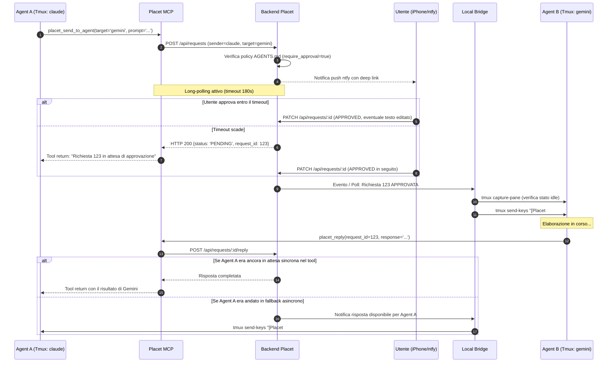

# Placet — Architettura di Sistema e Specifica Tecnica

> **Versione:** 1.0 — 14/10/2026 · **Stato:** Definito post-intervista di design  
> **Ruolo:** Hub unificato per Human-in-the-Loop e Bus di comunicazione cross-sessione tra agenti AI (Claude Code, Antigravity/Gemini, Codex, Ollama).

---

## 1. Visione d'Insieme

Placet risolve due problemi strutturali dei flussi di lavoro con agenti AI:
1. **Supervisione Human-in-the-Loop senza attrito:** Un unico punto di controllo mobile (iPhone via Tailscale + notifiche push immediate con `ntfy`) per approvare, rifiutare o modificare prompt e azioni critiche prima che vengano eseguite.
2. **Bus di comunicazione tra sessioni aperte di provider diversi:** Permette a sessioni interattive già avviate in terminale (es. Claude Code, Gemini CLI / Antigravity, Codex) di scambiarsi quesiti, compiti e risposte in modo controllato, con approvazione umana facoltativa o regolata da policy.

```text
 ┌────────────────────────────────────────────────────────┐
 │                   iPhone (Paolo)                       │
 │  • Notifiche push immediate (ntfy con deep link)       │
 │  • PWA (Tailscale HTTPS): review, edit prompt, audit   │
 └───────────────────────────▲────────────────────────────┘
                             │
                             ▼  REST API / SSE (Tailscale)
 ┌────────────────────────────────────────────────────────┐
 │                Placet Backend (FastAPI)                │
 │  • Database SQLite (richieste, risposte, routing, log) │
 │  • Policy Engine (AGENTS.md, regole auto/manual)       │
 │  • Long-polling manager & notificatore ntfy            │
 └───────────────────────────▲────────────────────────────┘
                             │
            ┌────────────────┴────────────────┐
            ▼                                 ▼
 ┌─────────────────────┐           ┌─────────────────────┐
 │  Server MCP Placet  │           │ Local Bridge Daemon │
 │  (Python mcp SDK)   │           │ (tmux integration)  │
 └──────────▲──────────┘           └──────────▲──────────┘
            │ stdio                            │ tmux send-keys / capture-pane
   ┌────────┴────────┐                ┌────────┴────────┐
   ▼                 ▼                ▼                 ▼
[Tmux: agent-claude] [Tmux: agent-gemini] [Tmux: agent-codex] ...
 (Claude Code CLI)    (Gemini/Antigravity)     (OpenAI/Codex)
```

---

## 2. Componenti del Sistema

### 2.1 Backend Placet (`placet-backend`)
- **Stack:** Python 3.11+, FastAPI, SQLite, Pydantic, Uvicorn.
- **Responsabilità:**
  - Esporre le REST API per creazione, lettura, aggiornamento e annullamento delle richieste.
  - Gestire stream SSE (Server-Sent Events) o WebSocket per aggiornare la PWA in tempo reale.
  - Inviare notifiche push su smartphone tramite webhook `ntfy` self-hosted in tailnet. La notifica contiene solo il link alla PWA; prompt e contesto sono inclusi solo se il server ntfy non è pubblico.
  - Gestire la sincronizzazione bidirezionale con `AGENTS.md`.
  - Fornire endpoint di long-polling per le chiamate MCP sincrone.

### 2.2 Server MCP (`placet-mcp`)
- **Stack:** Python `mcp` SDK (Model Context Protocol).
- **Comunicazione con gli Agenti:** Standard stdio configurato nel file di configurazione MCP di ciascun client (`claude_desktop_config.json`, `.claude.json`, configurazioni Antigravity, ecc.).
- **Autenticazione & Identità:**
  - Ogni agente legge da variabili d'ambiente:
    - `PLACET_AGENT_ID`: nome univoco dell'agente chiamante (es. `claude`, `gemini`).
    - `PLACET_API_TOKEN`: token di autenticazione per impedire spoofing dell'identità.
- **Strumenti esposti:**
  1. `placet_ask_human(question, options, allow_custom_text, context)`: richiede approvazione/decisione all'utente.
  2. `placet_send_to_agent(target_agent, prompt, context, require_human_approval)`: invia un prompt a un'altra sessione registrata.
  3. `placet_reply(request_id, response, status)`: restituisce la risposta alla richiesta completata.
  4. `placet_list_agents()`: ottiene la topologia, lo stato (idle/busy) e le descrizioni degli altri agenti.
  5. `placet_check_status(request_id)`: verifica lo stato di una richiesta rimasta in sospeso oltre il timeout.

### 2.3 Bridge Locale (`placet-bridge`)
- **Stack:** Demone Python leggero che interagisce con il server locale e `tmux`.
- **Meccanismo di Iniezione:**
  - Monitora le sessioni tmux convenzionate (`agent-claude`, `agent-gemini`, `agent-codex`).
  - **Controllo stato Idle:** Prima di iniettare testo, usa `tmux capture-pane -p -t <session>` per analizzare le ultime righe e verificare che il processo sia al prompt di attesa input (evita di iniettare caratteri mentre un agente sta compilando o generando codice). Se occupato, accoda la richiesta e riprova con backoff.
  - **Iniezione prompt:** Quando una richiesta viene approvata (dall'utente o in auto-routing), inietta il prompt formattato con envelope:
    ```text
    [Placet Request #<ID> da <sender>]: <prompt>
    Quando hai terminato, rispondi usando lo strumento MCP placet_reply(request_id=<ID>, response="...").
    ```
  - **Risveglio Asincrono (Fallback):** Se la chiamata MCP originale dell'agente chiamante era andata in timeout tornando `PENDING`, quando la risposta finale è pronta il bridge inietta la risposta nel terminale dell'agente chiamante per farlo ripartire senza interruzioni.

### 2.4 Frontend PWA (`placet-pwa`)
- **Stack:** Vite, React, Tailwind CSS, Lucide Icons.
- **Deployment:** Servita come file statici direttamente da FastAPI o tramite Docker/Nginx.
- **Rete:** Accessibile tramite Tailscale HTTPS (`tailscale serve`).
- **Schermate Principali:**
  1. **Dashboard / Inbox Richieste:**
     - Schede di review per richieste in stato `PENDING`.
     - Visualizzazione chiara: Mittente → Destinatario (`claude` → `gemini` o `claude` → `human`).
     - Contesto dell'azione, motivazione dell'agente.
     - **Editor interattivo del prompt:** Possibilità per Paolo di ritoccare direttamente il testo prima di cliccare su `[Approva ed Invia]`.
     - Pulsanti rapidi: `[Approva]`, `[Rifiuta]`, `[Modifica]`.
  2. **Topologia & Regole Agenti:**
     - Elenco sessioni con stato live (idle, busy, offline).
     - Switch rapido per passare una rotta specifica da `Richiedi approvazione` a `Auto-routing`.
  3. **Audit Log & Storico:**
     - Traccia cronologica di ogni richiesta, prompt inviato, modifiche apportate e risposte restituite.

---

## 3. Gestione del Ciclo di Vita di una Richiesta



---

## 4. Modello Dati (SQLite)

### Tabella `agents`
- `id` (TEXT, PK): es. `claude`, `gemini`, `codex`, `human`
- `name` (TEXT): Nome visualizzato
- `description` (TEXT): Ruolo e specializzazione
- `tmux_session` (TEXT): Nome sessione tmux (es. `agent-claude`)
- `status` (TEXT): `idle`, `busy`, `offline`
- `last_heartbeat` (DATETIME)

### Tabella `routes`
- `source_agent_id` (TEXT, FK)
- `target_agent_id` (TEXT, FK)
- `require_approval` (BOOLEAN): default `true`
- `allowed` (BOOLEAN): default `true`

### Tabella `requests`
- `id` (INTEGER, PK AUTOINCREMENT)
- `sender_id` (TEXT, FK)
- `recipient_id` (TEXT, FK)
- `question_type` (TEXT): `single_choice`, `multi_choice`, `prompt_review`, `confirmation`
- `prompt` (TEXT): Testo originale proposto
- `edited_prompt` (TEXT): Testo eventualmente modificato da Paolo
- `context` (TEXT): Spiegazione del contesto / motivazione
- `options` (JSON): Opzioni a scelta multipla (se applicabile)
- `status` (TEXT): `PENDING`, `APPROVED`, `REJECTED`, `EXECUTING`, `COMPLETED`, `CANCELLED`, `EXPIRED`
- `created_at` (DATETIME)
- `decided_at` (DATETIME)
- `completed_at` (DATETIME)

### Tabella `responses`
- `id` (INTEGER, PK AUTOINCREMENT)
- `request_id` (INTEGER, FK)
- `responder_id` (TEXT, FK)
- `content` (TEXT): Risultato generato dall'agente target o scelta dell'utente
- `created_at` (DATETIME)

---

## 5. Configurazione Agenti: `AGENTS.md`

Un file unico con frontmatter YAML per le configurazioni strutturate e markdown testuale per le descrizioni qualitative:

```markdown
---
agents:
  claude:
    tmux_session: "agent-claude"
    token: "${PLACET_TOKEN_CLAUDE}"
    allowed_targets: ["gemini", "codex", "human"]
    default_timeout_seconds: 180
  gemini:
    tmux_session: "agent-gemini"
    token: "${PLACET_TOKEN_GEMINI}"
    allowed_targets: ["claude", "human"]
    default_timeout_seconds: 180

rules:
  claude -> gemini:
    require_approval: true
  gemini -> claude:
    require_approval: true
---

# Registro Agenti Placet

## Claude Code (`claude`)
- **Ruolo:** Agente di sviluppo principale, refactoring, architettura, orchestrazione e redazione test.
- **Provider:** Anthropic Claude 3.7 Sonnet.

## Gemini / Antigravity (`gemini`)
- **Ruolo:** Analisi di contesti ampi, ricerca su documentazione aggiornata, verifica di casi limite, supporto algoritmico.
- **Provider:** Google Gemini.
```

---

## 6. Sicurezza e Accesso

1. **Isolamento di Rete:** Il backend non è esposto sul web pubblico. È accessibile esclusivamente sulla tailnet privata tramite Tailscale.
2. **Autenticazione Agente-to-Placet:** Ogni agente si autentica con un Bearer token univoco (`PLACET_API_TOKEN`). L'identità è quella associata al token in `AGENTS.md`, mai un campo del corpo della richiesta. Un agente vede e annulla solo le proprie richieste e risponde solo a quelle indirizzate a lui. I token non vengono mai esposti da `/api/agents`.
3. **Autenticazione Umano (PWA):** Il backend ascolta su due ingressi. Il listener TCP `127.0.0.1` è per gli agenti. Il socket Unix è esposto sulla tailnet con `tailscale serve unix:<socket>`, e solo lì è accettato l'header `Tailscale-User-Login`, ristretto agli utenti in `PLACET_ALLOWED_USERS`. Decisioni, lista delle richieste e flusso SSE sono riservati all'umano.
   - *Limite noto:* finché backend e agenti girano con lo stesso utente Linux, gli agenti possono raggiungere socket e DB. L'isolamento completo richiede un utente dedicato o un container.
4. **Principio del Minimo Privilegio (RS-04):** Gli agenti non possiedono chiavi per pubblicare sui social o applicare modifiche critiche in autonomia: possono solo proporre e attendere la validazione di Placet.
