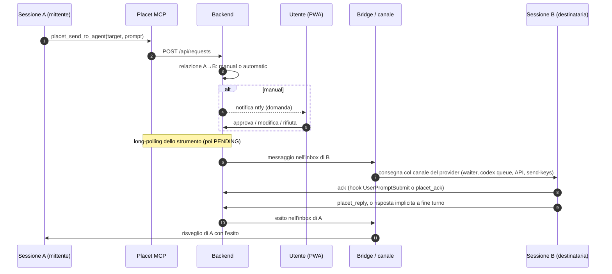

# Placet — Architettura di Sistema e Specifica Tecnica

> **Versione:** 2.0 — 16/10/2026 · **Stato:** Aggiornata dopo il laboratorio multi-provider ([LABORATORIO.md](LABORATORIO.md))
> **Ruolo:** Hub per Human-in-the-Loop, bus tra sessioni di provider diversi (Claude Code, Codex, Antigravity/Gemini) e vista delle sessioni sul telefono.

Le parti marcate *(da implementare)* sono decise ma non ancora nel codice.

---

## 1. Visione d'Insieme

```text
 ┌──────────────────────────────────────────────────────────────┐
 │ iPhone (Paolo)                                               │
 │  • Notifiche ntfy (domande; turni finiti)                    │
 │  • PWA su Tailscale: domande, sessioni, chat, progetti       │
 └──────────────────────────────▲───────────────────────────────┘
                                │ HTTPS (tailscale serve → socket Unix)
 ┌──────────────────────────────┴───────────────────────────────┐
 │ Placet Backend (FastAPI, utente di sistema `placet`)         │
 │  • SQLite: richieste, eventi, sessioni, nodi, relazioni      │
 │  • Decide chi riceve cosa e quando; long-polling; SSE        │
 │  • Non legge mai i file delle conversazioni                  │
 └───────▲──────────────────────▲──────────────────────▲────────┘
         │ REST (token agente)  │ REST (token agente)  │ REST /api/bridge/* (token bridge)
 ┌───────┴────────┐   ┌─────────┴─────────┐   ┌────────┴──────────────────────────┐
 │ Server MCP     │   │ Hook dei provider │   │ Bridge (servizio utente `paolo`)  │
 │ (stdio, uno    │   │ (eventi di turno, │   │  Adattatori per provider:         │
 │  per sessione) │   │  waiter Claude)   │   │  consegna · lettura chat ·        │
 └───────▲────────┘   └─────────▲─────────┘   │  contesto/consumi · comandi       │
         │                      │             └────────┬──────────────────────────┘
         └──────────┬───────────┘                      │ canale del provider
                    │                                  ▼
   ┌────────────────┴──────────────────────────────────────────────────┐
   │ Sessioni: Claude desktop/CLI · Codex desktop/CLI · Antigravity    │
   └───────────────────────────────────────────────────────────────────┘
```

Tre flussi:
1. **Domande e prompt** partono dalle sessioni (MCP), passano dal backend, arrivano a te (PWA) o a un'altra sessione (bridge).
2. **Eventi di turno** (inizio, fine, ultima risposta, strumenti usati) arrivano dagli hook di ogni provider: Placet sa quali sessioni esistono, se lavorano o sono ferme.
3. **Chat e consumi** li legge il bridge, a richiesta, dai file dei provider; il backend fa solo da tramite verso la PWA.

---

## 2. Componenti

### 2.1 Backend (`backend/app`)
- **Stack:** Python 3.11+, FastAPI, SQLite in WAL, Pydantic, Uvicorn.
- **Due ingressi nello stesso processo** (`serve.py`): TCP `127.0.0.1:8000` per agenti e bridge; socket Unix `/run/placet/human.sock` per la PWA via `tailscale serve`. Se uno dei due si ferma, si ferma tutto.
- **Responsabilità:** richieste e loro ciclo di vita, registro delle sessioni (dagli hook), inbox per sessione, decisione su chi riceve cosa, SSE (`request_update`, `session_update`), notifiche ntfy, sweeper di scadenze e riconsegne (ogni 30 s).
- *(da implementare)* nodi, progetti, relazioni e tipi; inoltro alla PWA delle pagine di chat lette dal bridge; consumi per provider.

### 2.2 Server MCP (`mcp_server`)
- Un processo stdio per sessione, configurato nel client: Claude (`.mcp.json` o `claude mcp add`), Codex (`codex mcp add`, in `~/.codex/config.toml`), Antigravity 2.0 (`~/.gemini/config/mcp_config.json`; **non** `~/.gemini/antigravity/mcp_config.json`).
- Identità da `PLACET_AGENT_ID` + `PLACET_API_TOKEN`.
- Strumenti: `placet_ask_human`, `placet_send_to_agent` (prompt o `prompt_file` Markdown), `placet_reply`, `placet_ack`, `placet_list_agents` (sessioni raggiungibili e non), `placet_check_status`.
- *(da implementare)* `send(target, type_id, prompt)` e l'elenco delle relazioni della sessione (RFC-08); attesa minima lato server per le domande all'umano (RF-09).

### 2.3 Hook dei provider (`hooks/`)
Trasformano gli eventi del client in fatti per Placet (`POST /api/sessions/{id}/events`: `start`, `prompt`, `tool`, `stop`, `end`). Non stampano nulla e non bloccano mai il client.

| Provider | File | Eventi usati | Note |
|---|---|---|---|
| Claude Code (app e CLI) | `~/.claude/settings.json` (globale) | SessionStart, UserPromptSubmit, PostToolUse `mcp__placet__.*`, Stop, SessionEnd | Stop contiene `last_assistant_message`. Hook asincroni con `asyncRewake` (waiter) |
| Codex | `<progetto>/.codex/hooks.json` | SessionStart, UserPromptSubmit, PostToolUse, Stop | Solo sincroni ("async hooks are not supported yet"); gli hook di progetto vanno approvati con `/hooks` *(da implementare)* |
| Antigravity 2.0 | `<progetto>/.agents/hooks.json` o `~/.gemini/config/hooks.json` | SessionStart, PreInvocation, PostToolUse, PostInvocation, Stop | JSON camelCase con `conversationId`, `transcriptPath`, `modelName`; solo sincroni; Stop senza ultima risposta (si legge dal transcript) *(da implementare)* |

### 2.4 Bridge (`bridge/`)
- Gira come **servizio utente systemd** dell'utente proprietario delle sessioni; parla col backend solo via `/api/bridge/*` con un token che non permette di decidere né leggere richieste.
- Oggi: consegna nelle sessioni tmux (`send-keys` dopo verifica di inattività: marcatori di occupato, `idle_patterns`, schermo stabile, testo attenuato scartato, nessun input recente).
- *(da implementare)* diventa un insieme di **adattatori per provider**, ciascuno con quattro capacità:

| Capacità | Claude | Codex | Antigravity 2.0 |
|---|---|---|---|
| Consegna / risveglio | waiter (hook asincrono) o `send-keys` | `codex queue --thread <id> --message <testo>` (binario dell'app, ≥ 0.159) | `SendUserCascadeMessage` sul language server dell'app (API interna) |
| "Subito" a metà turno | hook PostToolUse → `additionalContext` | da verificare (`turn/steer`) | hook PreInvocation → `injectSteps: [{userMessage}]` |
| Lettura chat | `~/.claude/projects/<cartella>/<id>.jsonl` | `~/.codex/sessions/AAAA/MM/GG/rollout-…-<id>.jsonl` | `~/.gemini/antigravity/brain/<id>/.system_generated/logs/transcript.jsonl` |
| Contesto | `message.usage` dell'ultima risposta | `token_count.info.last_token_usage` + `model_context_window` | da verificare (`/context`, statusline `agy`) |
| Limiti 5h / 7d | statusline di una sessione CLI di servizio (`rate_limits`) | `token_count.rate_limits` nell'ultimo rollout | statusline di una sessione `agy` di servizio (`quota.<bucket>`) |
| Compact / effort | solo CLI in tmux (`send-keys`); desktop: solo al PC | da verificare | da verificare |

### 2.5 PWA (`frontend/`)
- React + Vite, servita dal backend; Markdown con `react-markdown` + `remark-gfm` (HTML grezzo ignorato, link `javascript:` bloccati).
- Oggi: Inbox (sezioni Contesto / Prompt per X / Domanda, modifica del prompt), Sessioni, Storico con timeline.
- *(da implementare)*: home con domande in corso e sessioni aggiunte; vista chat di una sessione con risposta e scrittura; finestra "Aggiungi / vedi tutte"; barra dei consumi; grafo ed editor dei progetti.

---

## 3. Consegna e risveglio

**Regola (RF-21):** se una sessione ha una richiesta aperta, quando arriva l'esito Placet la sveglia con il canale del suo provider. Lo stesso vale per un prompt indirizzato a lei e per un tuo messaggio dalla PWA.

### 3.1 Claude Code — waiter asincrono
1. Gli hook SessionStart e Stop lanciano `placet_waiter.py` con `async: true, asyncRewake: true`.
2. Il waiter fa long-polling su `GET /api/sessions/{id}/inbox` (240 s), con un lock per sessione.
3. Quando arriva un messaggio lo stampa su stderr ed esce con codice 2: Claude Code sveglia la sessione con quel testo (nell'app compare come "Stop hook feedback").
4. *(da implementare)* Il waiter può morire durante un'attesa (osservato): il bridge controlla `waiter_seen_at` e, se manca, la sessione risulta irraggiungibile; serve un modo per ripristinarlo (es. controllo all'hook UserPromptSubmit, o waiter gestito dal bridge).

### 3.2 Codex — `codex queue` *(da implementare)*
- Il bridge consegna con il `codex` incluso nell'app desktop (`/usr/lib/chatgpt/resources/codex`); il messaggio entra come messaggio utente e avvia un turno, visibile in tempo reale nell'app.
- La risposta: `placet_reply` dell'agente, oppure l'ultimo `task_complete.last_agent_message` del rollout (risposta implicita).
- Nessun processo in attesa per sessione.

### 3.3 Antigravity 2.0 — API del language server *(da implementare)*
- Indirizzo e token: processo `language_server` dell'app (porta HTTP locale, `--csrf_token` nella riga di comando).
- `POST /exa.language_server_pb.LanguageServerService/SendUserCascadeMessage` (Connect, JSON, header `x-codeium-csrf-token`) con `cascadeId`, `items: [{text}]`, `deliveryStrategy: MESSAGE_DELIVERY_STRATEGY_WHEN_IDLE` e **`cascadeConfig`** copiata dall'ultimo `USER_INPUT` della conversazione (`GetCascadeTrajectory`). Senza `cascadeConfig` il turno fallisce.
- API non documentata: adattatore isolato, controllo di versione dell'app, ripiego su `agy` in tmux (RS-07).

### 3.4 CLI in tmux
- `send-keys` dopo la verifica di inattività (oggi).
- Le sessioni create da Placet partono con `--remote-control`, così si riprendono da app desktop, telefono e web.

### 3.5 Preambolo della consegna
- L'agente destinatario riceve solo il prompt, preceduto da `[Placet Request #N da <mittente>]`.
- Nel canale hook di Claude il preambolo chiede all'agente di riportare quello che ha ricevuto, perché l'app desktop non mostra il testo del risveglio.
- *(da implementare)* l'origine deve essere verificabile (l'agente può controllare la richiesta con uno strumento Placet): una sessione che riceve un prompt inatteso tende, giustamente, a trattarlo come prompt injection.

---

## 4. Ciclo di vita di una richiesta



Stati:
```text
PENDING ─decisione─► APPROVED / REJECTED          (EXPIRED alla scadenza, CANCELLED dal mittente)
APPROVED ─claim─► DELIVERING ─ack─► EXECUTING ─reply─► COMPLETED
    ▲                 │                  │  (reply esplicita o implicita a fine turno)
    └─ nessun ack ────┤ (max 3 tentativi, 90 s ciascuno)
                      │                  └─ oltre execution_timeout ─► STALLED
                      └────────────────────────────────► DELIVERY_FAILED
```

---

## 5. Lettura delle chat *(da implementare)*

```text
PWA ── GET /api/sessions/{id}/transcript?before=<cursore> ──► backend
backend ── lavoro "leggi chat" nella coda del bridge (/api/bridge/work) ──► bridge
bridge ── legge il file dal fondo, filtra, restituisce una pagina ──► backend (attesa max ~5 s) ──► PWA
```
- **Cursore:** posizione (byte o indice di passo) della voce più vecchia restituita; il bridge legge a ritroso a blocchi.
- **Filtro (RF-32):** messaggi dell'utente e risposte testuali; azioni come una riga; niente risultati dei tool né ragionamento. Voci di servizio scartate (Claude: `attachment`, `queue-operation`, `file-history-snapshot`, …).
- **Aggiornamento dal vivo:** l'evento `stop` di una sessione produce `session_update` via SSE; la PWA chiede solo i messaggi nuovi.
- **Sicurezza (RS-06):** il bridge risolve il file dalla sessione registrata (percorso dato dall'hook, verificato sotto le cartelle dei provider), mai da un percorso passato dal backend.

---

## 6. Modello Dati (SQLite)

### Esistenti
- **`requests`**: `id`, `sender_id`, `recipient_id`, `question_type`, `prompt`, `edited_prompt`, `prompt_source`, `context`, `options`, `selected_options`, `custom_text`, `status`, `priority`, `created_at`, `expires_at`, `decided_at`, `completed_at`, `updated_at`, `delivered_at`, `delivery_attempts`, `delivering_since`, `executing_since`, `sender_session_id`, `recipient_session_id`.
- **`responses`**: `request_id` (unico), `responder_id`, `content`, `implicit`, `created_at`.
- **`request_events`**: timeline per richiesta (`actor`, `event`, `details`, `at`).
- **`sessions`**: `id` (id del provider), `agent_id`, `provider`, `entrypoint`, `cwd`, `title`, `tmux_session`, `state` (idle/busy), `turn_request_id`, `started_at`, `last_seen_at`, `waiter_seen_at`, `ended_at`.
- **`agent_states`**: stato per agente (canale tmux).

### Da aggiungere *(da implementare)*
```text
nodes              (id, nome, provider, cartella)          "sessione Placet" con nome stabile
sessions.node_id   ─► nodes.id                              la sessione reale si aggancia al nodo
sessions.transcript_path                                    dal primo hook, per il bridge
projects           (id, nome)
project_nodes      (project_id, node_id)                    un nodo in più progetti
relation_types     (id, nome, descrizione)                  la descrizione la legge l'AI
relations          (id, da_node, a_node, type_id,           globale, unica per (da, a, tipo)
                    approval: manual | automatic)
project_relations  (project_id, relation_id)
requests.relation_id ─► relations.id                        per lo storico e l'audit
user_sessions      (session/node aggiunti alla home, ordine, notifiche)
```
- `context` resta per compatibilità con le richieste passate, ma non viene più richiesto (RF-05b).
- L'approvazione non viene mai restituita agli agenti (RFC-06).

---

## 7. Configurazione Agenti: `AGENTS.md`

Frontmatter YAML con agenti, token e parametri tecnici; Markdown con le descrizioni lette dagli agenti.

```markdown
---
agents:
  claude:
    tmux_session: "agent-claude"
    token: "${PLACET_TOKEN_CLAUDE}"
    allowed_targets: ["claude", "gemini", "codex", "human"]
    idle_patterns: ['^\s*[│|]?\s*[>❯]\s*(Try ".*")?\s*[│|]?\s*$']
  codex:
    token: "${PLACET_TOKEN_CODEX}"
    allowed_targets: ["claude", "gemini", "human"]
  gemini:
    token: "${PLACET_TOKEN_GEMINI}"
    allowed_targets: ["claude", "codex", "human"]
---
# Registro Agenti Placet
...
```

- In produzione il backend legge `/etc/placet/AGENTS.md` (`PLACET_AGENTS_FILE`).
- Le **regole** `A -> B: require_approval` sono sostituite dalle relazioni gestite dalla PWA (RFC-10) *(da implementare)*.

---

## 8. Sicurezza e Accesso

1. **Isolamento di rete:** il backend non è esposto su Internet; la PWA è raggiungibile solo sulla tailnet.
2. **Agenti:** Bearer token; identità dal token, mai dal corpo. Un agente vede e annulla solo le proprie richieste e risponde solo a quelle indirizzate a lui. I token non sono mai esposti da `/api/agents`.
3. **Umano:** l'header `Tailscale-User-Login` è accettato solo sul socket Unix esposto da `tailscale serve`, e solo per gli utenti in `PLACET_ALLOWED_USERS`. Scrivere a una sessione o crearne una equivale a comandare il PC: resta riservato a questa identità (RS-05).
4. **Isolamento dei processi:** il backend gira come utente `placet` (codice in `/opt/placet` di root, configurazione in `/etc/placet`, DB in `/var/lib/placet`, socket in `/run/placet` 0700). Docker non darebbe lo stesso risultato, perché il gruppo `docker` equivale a root.
5. **Bridge:** gira come l'utente delle sessioni, con un token che permette solo di leggere il lavoro da fare e segnare consegne. È l'unico componente che legge le chat, e solo dai percorsi dei provider per sessioni registrate (RS-06).
6. **API non documentate:** isolate negli adattatori, con controllo di versione e ripiego (RS-07).
7. **Limite noto:** gli agenti condividono lo stesso utente Linux e possono leggere i token l'uno dell'altro. I token distinguono gli agenti nell'audit, non li separano.
8. **Minimo privilegio (RS-04):** gli agenti non hanno chiavi per azioni pubbliche o distruttive; propongono e attendono il placet.
