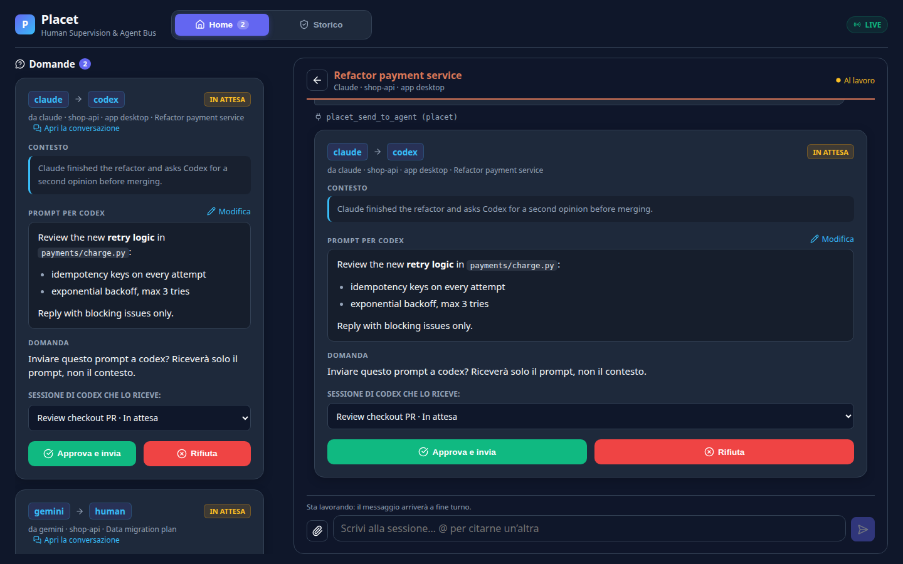
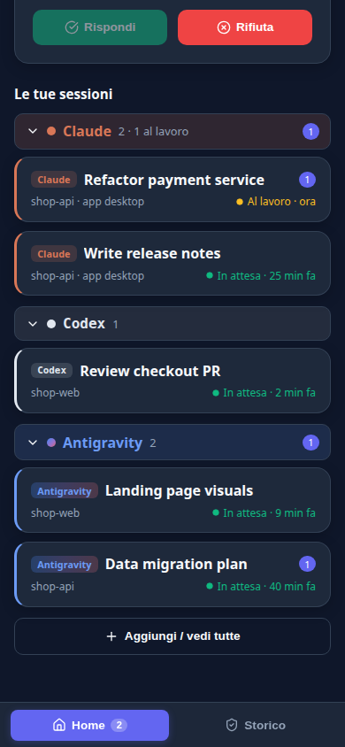
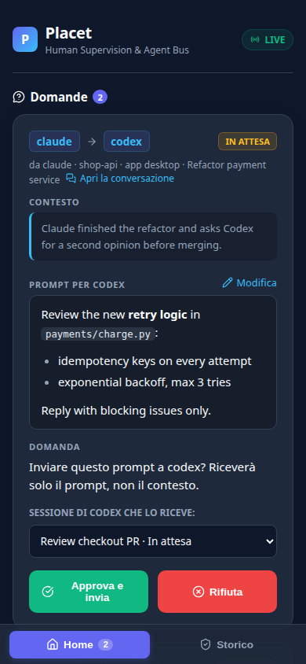
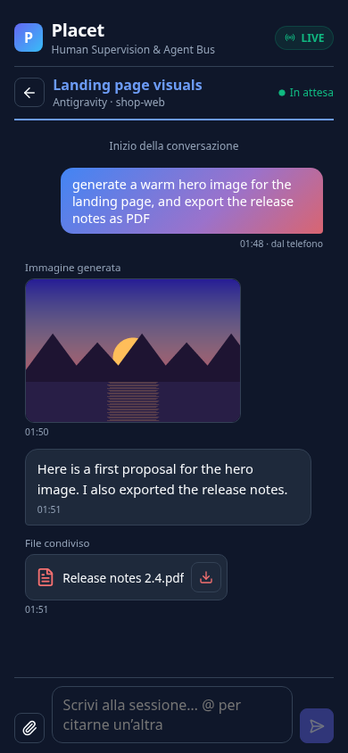
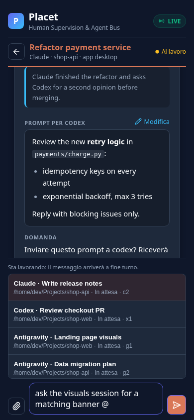
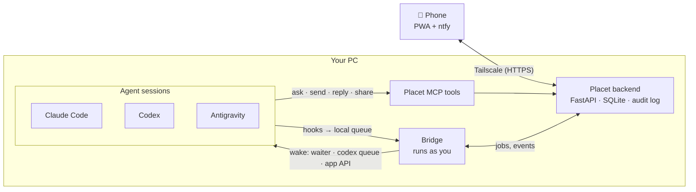

<h1 align="center">Placet</h1>

<p align="center">
  <strong>Your AI coding agents, in your pocket — and talking to each other, with your approval.</strong><br>
  A self-hosted hub for Claude Code, OpenAI Codex and Google Antigravity: follow every session from your phone,
  answer their questions, write to them, and let them hand work to one another only when you say so.
</p>

<p align="center">
  
</p>

> *Placet* (Latin, "it pleases"): the formal word for giving your consent. Nothing crosses from one agent to another without it.

---

## Why

If you run Claude Code, Codex and Antigravity side by side, you know the problems:

- **You are tied to the desk.** An agent stops to ask "may I run the migration?" and waits until you are back.
- **The agents cannot talk to each other.** You copy a plan from Claude into Codex for a review, then paste the review back.
- **When they *can* talk, nobody is watching.** Letting agents prompt each other unsupervised is how loops and surprises happen.

Placet sits between your agents and your phone. Every session registers itself; you read its conversation, answer its questions and write to it from anywhere. When one agent wants another to do something, the request comes to you first: approve it, edit the prompt, or reject it.

## Features

<table>
  <tr>
    <td align="center" width="25%"><br><sub><b>Every session, by provider</b><br>with live state and pending questions</sub></td>
    <td align="center" width="25%"><br><sub><b>Agent → agent, approved by you</b><br>edit the prompt, pick the target session</sub></td>
    <td align="center" width="25%"><br><sub><b>Conversations with attachments</b><br>images, generated pictures, shared PDFs</sub></td>
    <td align="center" width="25%"><br><sub><b>Mention another session with @</b><br>the agent prepares the request</sub></td>
  </tr>
</table>

- **One inbox for all your agents.** Questions from Claude, Codex and Antigravity arrive as push notifications (via [ntfy](https://ntfy.sh)) and as cards in a PWA you add to your home screen.
- **Read and write to any session.** The conversation as you see it on the PC: Markdown, highlighted code, tool calls collapsed into one line. Write a message and it wakes the session, as if you had typed it at the desk.
- **An approval bus between agents.** `placet_send_to_agent` lets an agent ask another one for a review, a test run or a second opinion. You approve, edit or reject; the answer goes back to the session that asked.
- **Attachments both ways.** Images you pasted in the desktop apps, pictures an agent generated, PDFs it shared with `placet_share_file`, and photos or files you attach from the phone.
- **Reliable by design.** Hooks write to a local queue and never block a turn. Each request tracks *delivery*, *execution* and *reply* separately; an uncertain delivery is never re-sent behind your back. One request at a time per session, and time alone never frees the queue.
- **Adaptive.** Two columns on the desktop, a bottom bar on the phone, a theme per provider.

## How it works



- **Backend** — runs as its own system user, keeps requests and the audit log, and is reachable from your phone only through your [Tailscale](https://tailscale.com) network. It never stores your conversations.
- **Bridge** — runs as you: it reads conversations on demand, wakes sessions, forwards hook events from the local queue and checks which projects are excluded.
- **Hooks** — every Claude Code, Codex and Antigravity session registers itself and reports when a turn starts and ends. Sessions stay quiet until a Placet message arrives; a `.placet-off` file keeps a project out entirely.
- **MCP tools** — `placet_ask_human`, `placet_send_to_agent`, `placet_reply`, `placet_share_file` and friends, available to every agent.

| Provider | Registers with | Woken by |
|---|---|---|
| Claude Code (desktop app and CLI) | hooks | a background waiter (`asyncRewake`) |
| OpenAI Codex (desktop app and CLI) | hooks | `codex queue` |
| Google Antigravity 2.0 | hooks | the app's language server |

## Security, briefly

- **Two doors.** Agents talk to `127.0.0.1` with their own token; you reach the PWA through a Unix socket exposed with `tailscale serve`, and only the Tailscale logins you allow get in.
- **Least privilege.** The backend has no access to your files. The bridge reads only what a page or an attachment needs, and an attachment is requested by id, never by path.
- **Attachments are checked.** Only files the provider adapter recognised, inside the folders the app uses for that conversation (symlinks resolved), and real JPEG, PNG, WebP or PDF content. Shared files are never taken from hidden folders like `.ssh`.
- **Honest limits.** Agents run as your user and could read each other's tokens: tokens identify agents in the audit log, they do not isolate them. Some integrations rely on undocumented app internals and may break on updates; they are isolated in adapters.

More in [ARCHITETTURA.md](ARCHITETTURA.md) (Italian).

## Quick start

Placet targets **Linux** with **Python 3.11+**, **Node.js 18+**, [Tailscale](https://tailscale.com) and, for push notifications, an [ntfy](https://ntfy.sh) server.

```bash
git clone <this repository> placet && cd placet
sudo deploy/install.sh                  # backend service, bridge service, PWA build
python3 /opt/placet/hooks/install.py    # hooks for Claude Code, Codex and Antigravity
sudo tailscale serve --bg unix:/run/placet/human.sock
```

Then add the Placet MCP server to your agents, approve the Codex hooks once with `/hooks`, restart the apps, and open `https://<your-machine>.<tailnet>.ts.net` on your phone.

The complete guide — environment variables, notifications, MCP setup, the tmux channel — is in [docs/INSTALL.it.md](docs/INSTALL.it.md) (Italian).

## Status

Placet is **alpha**, used every day by its author on one machine. English and Italian interface localization is rolling out, starting with reply approvals and history. Other screens and the design documents still contain Italian. See [localization scope and contributor rules](docs/localization.md).

- ✅ Questions and approvals from the phone, push notifications, audit log
- ✅ Sessions on the phone: read, write, wake (Claude Code, Codex, Antigravity)
- ✅ Reliability: local event queue, delivery / execution / reply, one request at a time
- ✅ Attachments: viewing, `placet_share_file`, uploads from the phone; `@` mentions
- 🚧 "Right now" messages inside a running turn, distinct notifications, waiter health
- 🗺️ Typed relations between sessions with per-relation policy (manual / automatic), loop limits, a graph editor
- 🗺️ Usage, context and effort per session; creating sessions from the phone

Design notes: [REQUISITI.md](REQUISITI.md) (requirements) · [ARCHITETTURA.md](ARCHITETTURA.md) (architecture) · [LABORATORIO.md](LABORATORIO.md) (experiments).

## Development

```bash
python3 -m venv .venv && .venv/bin/pip install -r requirements.txt
.venv/bin/python -m pytest -q                    # backend, bridge, hooks
cd frontend && npm install && npx vitest run     # PWA
.venv/bin/python run_all.py                      # backend + bridge in one process (development only)
```

## Contributing

Issues and pull requests are welcome, especially adapters for other agents and checks on new versions of the supported apps. Please keep the two rules that shape the project: nothing reaches an agent from another agent without passing through Placet's policy, and nothing on the phone reveals a file the user did not choose to share.

## License

Licensed under the [Apache License 2.0](LICENSE). Copyright 2026 Paolo Pietrelli.
