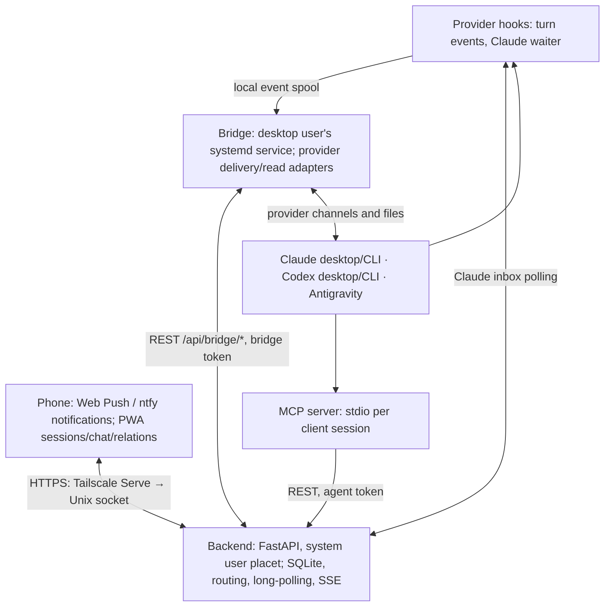

# Placet system architecture and technical specification

> **Baseline:** version 2.1, 2026-10-16, following the [multi-provider laboratory](experiments/provider-integration.md).
> **English documentation update:** 2026-10-18, incorporating the later delivery, wakeup, attachment, return-approval and localization decisions.
> **Role:** human-in-the-loop hub, cross-session bus for Claude Code, Codex and Antigravity/Gemini, and phone session viewer.

Items marked **planned** are agreed designs, not implemented capabilities. Historical observations and provider-version limits remain in the [experiments](experiments/provider-integration.md); they are not public provider API guarantees.

## 1. Overview



Three flows:

1. **Questions/prompts:** sessions → MCP → backend → human PWA or another session's provider channel.
2. **Turn events:** provider hooks report start/end, final response and relevant tool use, registering sessions and observing busy/idle state.
3. **Chat/usage:** bridge reads provider files on demand; backend relays results to the PWA. Usage/context/control adapters are partly planned, not all exposed in the product.

## 2. Components

### 2.1 Backend (`backend/app`)

- Python 3.11+, FastAPI, SQLite WAL, Pydantic, Uvicorn.
- **Two listeners in one process** (`serve.py`): TCP `127.0.0.1:8000` for agents/bridge; Unix socket `/run/placet/human.sock` in production for the PWA through Tailscale Serve. If either listener stops, the process stops.
- Requests/lifecycle, hook-driven session registry, per-session inboxes, routing, SSE (`request_update`, `session_update`, `usage_update`, `automation_update`), notifications and a 30-second expiration/redelivery sweeper. Notifications go through Web Push to the installed PWA (VAPID keys generated on first use and kept in the database; only browser vendors' push services are contacted; payloads carry a short title, never request text) and through ntfy when configured. Notification preferences are managed via human-only `GET/PUT /api/settings/notifications` and stored in `app_settings` under `notification_preferences` (`needs_you`, `problems`, `queue_held`, `turn_end`); preferences currently apply globally to all devices. Deliver-at-reset preference is managed via human-only `GET/PUT /api/settings/deliver-at-reset` and stored in `app_settings` under `deliver_at_reset` (`enabled`).
- Relays bridge-read conversation pages (§5).
- **Planned:** nodes, projects and relations/types. Provider usage is now reported by the bridge and shown in the PWA.

### 2.2 MCP server (`mcp_server`)

- stdio process configured in each client: Claude `.mcp.json`/`claude mcp add`; Codex `codex mcp add`/`~/.codex/config.toml`; Antigravity 2.0 `~/.gemini/config/mcp_config.json`, **not** `~/.gemini/antigravity/mcp_config.json`.
- Authentication through `PLACET_API_TOKEN`; optional `PLACET_AGENT_ID` must match token identity.
- Tools: `placet_ask_human`, `placet_send_to_agent` (inline prompt or Markdown `prompt_file`), `placet_reply`, `placet_progress` (progress without concluding, RFC-16), `placet_project_view` (read-only coordinator view, RFC-17), `placet_ack`, `placet_list_agents` (reachable/unreachable sessions), `placet_check_status`, `placet_share_file`.
- Human questions wait at least 60 seconds (RF-09). A timeout ends tool waiting, not the request's lifetime.
- **Planned:** typed `send(target, type_id, prompt)` and outgoing-relation discovery (RFC-08). Human-question `context` is still required; removing it remains RF-05b.

### 2.3 Provider hooks (`hooks/`)

Convert client events into Placet observations (`POST /api/sessions/{id}/events`: `start`, `prompt`, `tool`, `stop`, `end`). Normal event hooks write to the local spool rather than wait on HTTP. `hooks/install.py` installs globally and changes only Placet entries (RF-42). Sessions are **present but quiet**: ordinary turns report lifecycle events; only Placet work collects a response. `placet_common.active(cwd)` excludes folders with `.placet-off` in that folder or an ancestor (RF-45).

| Provider | User configuration | Events | Notes |
| --- | --- | --- | --- |
| Claude Code desktop/CLI | `~/.claude/settings.json` | SessionStart, UserPromptSubmit, Placet PostToolUse, Stop, StopFailure, SessionEnd; steering PostToolUse | Stop supplies `last_assistant_message`; asynchronous `asyncRewake` waiter. StopFailure (a turn ended by an API error such as `rate_limit`) is reported as `failed` with the error code: no reply, the request stays open and in flight (the queue stays held), the next turn in that session (e.g. "continue" typed in the app) resumes it, the session shows the error and the user is notified; Claude Code 2.1.284 or later; its output is ignored by Claude Code, so no waiter starts and the session is unreachable until the user writes to it. Desktop SessionEnd suspends; CLI SessionEnd closes. Continued conversations (RF-29d) are detected on the first prompt, closing the previous session as continued and transferring its Home pin and node. Recovery opens only eligible desktop sessions with mail and no reachable waiter; [details](providers/claude-wake.md). |
| Codex | `~/.codex/hooks.json` | SessionStart, UserPromptSubmit, PostToolUse, Stop, SessionEnd | Shared `claude_code.py --provider codex` adapter for compatible fields. Synchronous only in tested versions (“async hooks are not supported yet”); review with `/hooks`. Desktop SessionEnd unloads/suspends (RF-29c); bridge queues once and requests a native-link reopen without asserting execution started. |
| Antigravity 2.0 | `~/.gemini/config/hooks.json` | SessionStart, PreInvocation (first invocation begins the turn), Stop | `antigravity.py`; camelCase `conversationId`, `transcriptPath`, `modelName`. Synchronous hooks must print `{}`. Stop lacks final response; adapter reads it from the conversation file. |

A Claude Code `SessionStart` with source `compact` during a busy turn preserves the turn state and its Placet request binding. Compaction is not a new user turn: the following `Stop` completes the original request and releases its queue normally.

Hook approval and invocation must be verified against the installed app version. A configuration file alone is not evidence that execution events are being observed.

### 2.4 Bridge (`bridge/`)

- **systemd user service** of the session owner. Production communication is only through `/api/bridge/*` using a bridge token; that token cannot approve human decisions or read arbitrary requests.
- tmux delivery uses `send-keys` after idle checks: busy markers, `idle_patterns`, stable screen, dim hints ignored, no recent keyboard input.
- Provider adapters in `bridge/channels.py` and `bridge/transcripts.py`. For Codex/Antigravity, backend work lists sessions with mail; bridge claims it (`POST /api/bridge/sessions/{id}/take`), queues it in the app and confirms (`…/injected`), or releases it after a definite rejection. Uncertain outcomes follow §3.7 rather than blind retry.

| Capability | Claude | Codex | Antigravity 2.0 |
| --- | --- | --- | --- |
| Delivery/wakeup | Hook waiter or configured tmux `send-keys`; private desktop recovery link if waiter absent | App `codex queue --thread <id> --message <text>` (tested app binary ≥0.159); native link for suspended desktop sessions | Internal `SendUserCascadeMessage` language-server API |
| Now during a turn | PostToolUse `additionalContext` | Not enabled; `turn/steer` needs adapter verification | `MESSAGE_DELIVERY_STRATEGY_NEXT_INVOCATION`; live validation still needed |
| Chat read | `~/.claude/projects/<folder>/<id>.jsonl` | `~/.codex/sessions/YYYY/MM/DD/rollout-…-<id>.jsonl` | `~/.gemini/antigravity/brain/<id>/.system_generated/logs/transcript.jsonl` |
| Context source (planned display) | Latest assistant `message.usage` | `token_count.info.last_token_usage`, `model_context_window` | Verify `/context`/`agy` statusline |
| 5h/7d limit source (planned display) | Service CLI statusline `rate_limits` | Latest rollout `token_count.rate_limits` | Service `agy` statusline `quota.<bucket>` |
| Compact/effort (RF-62) | tmux CLI: `/compact` and `/effort <level>` typed through a bridge job (`session_command`); desktop PC-only | Unsupported (`codex queue` ignores overrides) | Unsupported until verified |

Sources observed in experiments do not imply all corresponding product controls are implemented. A tmux alternative must target an explicitly configured session; it is not permission to resume a desktop transcript in another writer.

### 2.5 PWA (`frontend/`)

- React/Vite, served by backend. Markdown via `react-markdown`/`remark-gfm`; raw HTML ignored and `javascript:` links blocked.
- **Hash routes:** `#/` Home, `#/progetti` and `#/progetti/<id>` projects, `#/impostazioni` settings (app and background language, Web Push, and the way to the history), `#/storico` history (opened from Settings), `#/sessione/<id>[?project=<id>]` session. The navigation has Home, Projects and Settings; the app bar keeps only the live indicator. Notification `#request-N` links resolve to the originating conversation, Home or history. Route identifiers remain unchanged across languages.
- **Home** (`Home.jsx`): current questions, then pinned sessions ordered by `activity_at` (turn start/end, not waiter polls), provider/state/question count. **Add / view all** (`AddSessionsDialog.jsx`) handles one provider at a time; checkbox controls `PUT /api/sessions/{id}/pin`, including removal of closed sessions.
- **Conversation** (`SessionView.jsx`, `useTranscript.js`): pages from `/api/sessions/{id}/transcript`, initial bottom position, older pages on upward scroll with position retention; `session_update` requests new entries through `after`. Consecutive actions collapse into groups. Open session questions appear at the bottom.
- **History** (`History.jsx`): per-request timeline and three-aspect state.
- **Composer** (`Composer.jsx`): `POST /api/sessions/{id}/messages`; pending/delivering/failed state remains visible. Mentions, phone uploads, scheduling (`datetime-local` picker stored as UTC ISO) and supported Queue/Now selection are implemented.
- **Localization:** English/Italian with English fallback and device-local preference; separate shared background-message language. [Full contract](localization.md).
- **Usage bar:** provider windows, with account-wide exhausted windows holding delivery until reset. **Planned:** project graph/editor. No service worker is installed; [cache behavior](experiments/2026-10-18-session-integration.md#pwa-updates-and-caching).

## 3. Delivery and wakeup

**RF-21:** when an authorized outcome, addressed prompt or human PWA message is deliverable, Placet attempts delivery through the recipient's provider channel. Return approval and reachability still apply.

### 3.1 Claude Code: asynchronous waiter

1. SessionStart and Stop launch `placet_waiter.py` with `async: true, asyncRewake: true`.
2. Waiter long-polls `GET /api/sessions/{id}/inbox` (240 seconds), with one lock per session.
3. On mail it writes the text to stderr and exits with code 2; Claude wakes the session (“Stop hook feedback” in the app).
4. Waiter death was observed in the laboratory. Timeout is now seven days; lock/engine-owner identity checks guard replacement. Bridge checks `waiter_seen_at`; an unavailable eligible desktop session with mail may be opened through the private continuation link. A waiter must still originate from a Claude hook, not an external attachment to an existing engine. [Recovery and limits](providers/claude-wake.md).

### 3.2 Codex: `codex queue`

- Bridge uses the app's Codex binary (`/usr/lib/chatgpt/resources/codex` in the tested Linux package). A **loaded** thread receives a user message and starts a turn visible live in the app.
- Suspended/unloaded threads require queueing **once**, then `/usr/bin/chatgpt codex://threads/<uuid>`. Opening can bring the window forward. Accepted queue items are not guaranteed retractable; link success is not turn-start proof. [Details](providers/codex-wake.md).
- Response: explicit `placet_reply` or observed final turn text, including rollout `task_complete.last_agent_message` in the tested format. Completion/return approval remain separate.
- No waiting process per session; no headless `exec resume` fallback and no app-server proxy.

### 3.3 Antigravity 2.0: language-server API

- Discover the app's `language_server` process (`--csrf_token`, `--override_ide_version` command line, ports from `/proc`). Select/cache the server that returns the target conversation.
- `POST /exa.language_server_pb.LanguageServerService/SendUserCascadeMessage`, Connect JSON, `x-codeium-csrf-token` header; body has `cascadeId`, `items: [{text}]`, `deliveryStrategy: MESSAGE_DELIVERY_STRATEGY_WHEN_IDLE` and **`cascadeConfig` copied from the latest `USER_INPUT`** returned by `GetCascadeTrajectory`. Without it the tested turn fails. The configuration is taken from the **most recent** step that has one (`userConfig`, else `lastUserConfig`), never from an older step because of the field name. **Reading the latest user step as a stream:** when the ordinary snapshot lacks the configuration, `GetCascadeTrajectorySteps` is asked from `stepOffset = lastUserInputStepIndex`; the answer holds every step to the end (12 MB for 137 steps in a real case) but the wanted step is the first, so `bridge/stream_json.py` reads the answer as a stream and stops as soon as the first element of `steps` is complete (a validating scanner: the fields before `steps` and the step itself are held to the JSON grammar, with legal scalars, matching delimiters, valid escapes, no raw control characters and nesting of at most 200 levels, then `json.loads` builds the step; UTF-8 split between chunks is handled; what follows the step is never read, so never judged), capped at 2 MiB for that step and, counted in **bytes**, 1 MiB for what precedes it, read in 16 KiB chunks so that stopping early overshoots by at most one. It must still be a `USER_INPUT` whose `createdAt` equals `lastUserInputTime`. A first step too big, an answer cut short or not JSON fails before any send with `user_config_unreadable` (deterministic, like `missing_user_config`, with the general PWA words); HTTP errors and timeouts stay as before. **A conversation with none (`missing_user_config`) blocks delivery, visibly:** the channel raises `ChannelError` with a closed `code` and `phase="pre_dispatch"` (nothing was sent: also `conversation_unavailable` when the app is not running); the bridge re-reads once (deterministic codes only), then reports `POST /api/bridge/sessions/{id}/delivery-block` (code and phase only, never a configuration or the app's words) and stops polling that session. The block lives in the backend (`delivery_blocks`, so it survives a bridge restart): `failed_attempts` counts channel attempts apart from `delivery_attempts`; the bridge is told again after 5, 15, then 60 minutes (deterministic) or 6 s doubling to 5 minutes with ±20 % jitter (transient), as one probe (`probing`) whose success ends the episode (`DELETE`); new messages to the session do not reset it; the user's "Riprova consegna" (`POST /api/sessions/{id}/delivery-block/retry`) makes it due at once and restarts the backoff. One push per episode (not per request). The held requests are listed under "Consegna bloccata" (`cause: delivery_blocked`, with the `block` code, attempts and times) with forward and cancel. A failure after a possible dispatch stays `uncertain` (no automatic retry); an unclassified `ChannelError` behaves as before.
- Undocumented, version-sensitive API isolated in an adapter. Configured `agy`/tmux is an alternative channel, not a guarantee of safe automatic desktop-thread failover (RS-07).

**Configuration recovery.** When `GetCascadeTrajectory` omits user-input payloads, delivery reads the same
conversation's live summary and calls `GetCascadeTrajectorySteps` with
`stepOffset=lastUserInputStepIndex` and `verbosity=1`. The requested first step
must be a user input; its timestamp must match a non-empty `lastUserInputTime` from the summary.
Only that step may supply the model/tool configuration. The answer is read as a
stream and only its first step is kept (at most 2 MiB; the rest is never downloaded).
Missing, misaligned, oversized or unreadable results remain pre-dispatch delivery
blocks: no message is sent, no configuration is invented or copied from another
conversation, and no historical configuration is cached.

This fallback addresses a live discrepancy observed on 2026-10-28: the ordinary
trajectory returned 26,668 steps without user-input payloads, while the summary
reported 27,395 steps. Reading from offset 27,382 returned 13 recent steps,
including the latest user input with its configuration. The validation was
read-only; it neither sent a message nor cleared the pending delivery block.

### 3.4 CLI in tmux

- `send-keys` only after idle verification.
- **Planned Placet-created sessions:** launch CLI with Remote Control so it can be accessed from desktop, phone and web; experimentally verified for Claude. Session creation is not currently implemented.

### 3.5 Delivery preamble

- Recipient receives only the task prompt, with an identifiable `[Placet Request #N ...]` prefix. Generated prose follows the shared background language; IDs/tool names are stable.
- Claude hook delivery asks the agent to report the incoming sender/task because the desktop app may hide wakeup text.
- Human PWA messages (`question_type: message`) use an English or historical Italian user prefix and a brief note: reply directly, no `placet_reply`; the turn itself is the response. PWA displays them as user messages.
- **Planned:** stronger verifiable-origin protocol so an unexpected prompt can be checked through Placet rather than trusted solely because of its text.

### 3.6 Local event spool

RF-28: `hooks/spool.py`, `bridge/spool_forwarder.py`.

- Hooks write to `~/.cache/placet/spool/` (0700 directory, 0600 files) using a same-directory temporary file and atomic rename, then exit. No `fsync`; power loss may lose an event.
- Filename `<boot_id>-<monotonic-counter>-<event_id>.json`; payload includes `event_id`, `boot_id`, `seq`, `agent`, `provider`, `session_id`, `kind` (start, prompt, Placet-tool event, stop, end), `at`, `cwd`, event data. Order is observed per session.
- Final assistant text is captured at turn end into the event; Antigravity reads the transcript then, with brief retries, rather than later during forwarding.
- One locked bridge consumer watches with inotify plus startup/periodic full scans. It forwards in per-session order using agent authentication, removing files only after backend persistence/acknowledgement. Backend deduplicates `event_id` for 14 days.
- Retry 429, 5xx, 401/403 and network failures with backoff. Malformed/permanently rejected events go to `spool/failed/` without blocking others. At 50 MB, new events are discarded; a dedicated PWA capacity warning is still planned. Abandoned temporary files older than an hour are cleaned up.
- Claude waiter polling and Now steering use separate paths. Steering consumes a local file written by the bridge.

### 3.7 Delivery, execution and reply

RF-29/RF-29b. Independent aspects, each with evidence/timestamps; observations may arrive out of order:

- **Delivery:** waiting → delivering (attempt with `attempt_id`) → accepted (channel command succeeded), uncertain, failed or cancelled. Seeing the message in the conversation adds evidence.
- **Execution:** unobserved → started (turn opened by the message) → completed/interrupted.
- **Reply:** none, explicit (`placet_reply`), implicit (final turn response), ambiguous (other messages entered the turn).

The recognizable `[Placet Request #N` prefix supports reconciliation. The design includes `attempt_id`, but the current conversation text does **not** include it; any matching request prefix is treated as delivery evidence, regardless of attempt.

One request remains in flight per session until conclusion. Short acknowledgement deadlines trigger reconciliation; long execution deadlines only warn. Uncertain delivery does not free the next request; the user decides Retry/Cancel. `placet_reply` alone is not proof that execution ended.

Implementation:

- `requests` columns include `delivery_state`, `delivery_at`, `delivery_channel` (tmux/waiter/bridge), `attempt_id`, `execution_state`, `execution_at`, `execution_source`, `reply_state`, `turn_mixed`. `status` remains the summary exposed to agents/MCP.
- Claim by waiter/bridge → delivering. Turn-start hook, `placet_ack`, response or matching transcript message → accepted. Turn start → execution started; turn end → completed; session end during a turn → interrupted.
- Channel timeout (Codex queue beyond 60 seconds; Antigravity without a response), or no acknowledgement within 90 seconds for waiter/bridge → **uncertain**, with notification. Only tmux retains three automatic acknowledgement attempts. Bridge reconciles every 20 seconds by reading the conversation for the prefix.
- A prompt without `request_id` during a request's open turn marks it mixed; implicit response becomes **ambiguous**.
- Next request stays blocked while delivery is underway/uncertain, or accepted with execution unobserved/started, even if `STALLED`. **Time never releases the queue.** After 120 seconds without observed start, warn “start unconfirmed”; STALLED means “needs checking”. Require observed turn end or explicit user action.
- Human release actions: **Confirm finished** (`marked_finished_by_user`) or **Queue the next anyway** (`queue_overridden`), both `POST /api/requests/{id}/queue/release` with `reason`. Neither fabricates execution evidence. Cancel after delivery stops Placet waiting; it cannot stop the agent. Now (RF-35) explicitly inserts into the current turn.
- **Missing MCP connection (RF-27):** `hooks/mcp_check.py` (stdlib, read-only) turns the provider's configuration files into `configured | missing | unknown` (the configuration detected, never the connection: a switched-off, refused or unapproved entry is `unknown` (and an off anywhere wins over an entry found elsewhere), and `missing` means "not found in the files checked"); `claude_code.py` and `antigravity.py` put it in the `start` event as `mcp`, and the Claude Code hook prints a SessionStart `additionalContext` when it is `missing`. The backend keeps configuration and use apart: `sessions.mcp_state` / `mcp_checked_at` are what the hook reported at the latest start and when (each start replaces them), `mcp_seen_at` is the last time an MCP call carried the session (reply, progress, ack, a request sent from it, `placet_list_relations` by its session id, `placet_check_status` by the caller's own end of the request); a use is evidence of past use and never rewrites the configuration. Nothing is inferred from how a turn ends (there was a `suspect` heuristic for a Placet turn ending with no MCP call; it was wrong, because a healthy session never needs one: the waiter delivers phone messages, the reply comes from the transcript, agent requests accept implicit replies, and it was removed, with old rows migrated to `unknown`). The connection itself is only known from an observed MCP call. The PWA warns, in careful words, for `missing` only, unless the session was seen using the MCP since the start that reported it (`mcpWarning`); the SessionStart notice asks the agent to check its available tools before telling the user.
- **Continued Claude Code conversations (RF-29d):** the hook sets `continues` on a prompt from the continuation summary in the prompt text or, failing that, from the first lines of the session's own transcript (`continued_from_transcript`, Claude Code only: the decoded first user record must start with the continuation phrase and name exactly one other transcript, never the transcript's own id; service records before the first conversation record are skipped, the read is bounded to 64 records or 1 MB). On the first prompt the backend (`continue_session`) closes the previous session as continued and moves its pin and `node_id`; relations, `placet_list_relations` and project membership follow the node, so nothing else moves.
- **Binding an agent-addressed request (RF-29g):** `POST /api/requests` with `recipient_id` and neither `recipient_session_id` nor `target_node` resolves the recipient session at creation (`bind_unaddressed_session`): reachable sessions of the agent other than the sender session itself, narrowed to the sender session's `cwd`; one candidate is bound, several (or none in the folder while others exist) return `409 request.target_session_ambiguous` with `params.candidates` and `params.other_sessions`, and nothing is created. The MCP tool returns it as `product_code`/`params`. When no session is reachable the single waiting (suspended or waiter-less) session of that folder is bound, so a session of another folder cannot claim it later; waiting sessions only elsewhere give `409 request.target_session_unreachable`. Unbound requests therefore remain only for agents with no session, or only tmux-driven ones.
- **Held-queue alerts (RF-29e):** the periodic sweep (`expire_and_notify`) that flags unseen starts and stalled work also sends one Web Push per held request (`hold_alerted_at`) once it has held the queue for 10 minutes with an approved message for the same session waiting; nothing is marked while `queue_held` is off. The PWA mirrors the rule (`queueStuck`, built on `holdsQueueUnseen`) for the Home badge.
- **Release on evidence (RF-29f):** the Stop hook (without `pause`) and a `prompt` that starts a new turn call `release_on_observed_turn_end`: answered requests (status COMPLETED with a response) still holding the session's queue get `queue_released_at` and a `released_on_observed_turn_end` event by `system`. Elapsed time never releases. A `turn_paused` without a later `turn_resumed` for 30 minutes sets `start_unconfirmed_at` once (`pause_unresumed`); the queue stays held.
- **Remote compact and effort (RF-62):** `session_controls()` computes `SessionModel.controls` from provider, tmux session and entrypoint. The endpoints build the line with `command_text()` (fixed `/compact` or `/effort <level>` from an allowlist) and send a `session_command` bridge job carrying only the command, the level, the agent and its tmux session; The job carries the Placet session id, the pane id (`sessions.tmux_pane`, from `$TMUX_PANE` in the hooks) and the identity proof the hook reported (`tmux_server` from `$TMUX`, `agent_pid` and `agent_started` from `/proc`, via `placet_common.agent_process`); the bridge checks them with `tmux display-message '#{pid} #{pane_pid} #{session_name}'` and `bridge/procs.py` (the agent process alive with the same start time, a descendant of the pane's process), because `%N` is reused after a tmux restart; the backend refuses a session that another session has superseded in that pane (`db.pane_occupants`); `bridge/session_commands.py` re-validates, requires the pane to exist and belong to the tmux session configured for the agent (never one a message names), and uses the pane id for every tmux operation (idle check, input check, `send-keys`) under the bridge's per-tmux-session lock, which normal deliveries take too. After Enter the bridge sleeps `SETTLE_SECONDS` (1 s) and calls `check_idle` on the pane, still under the lock: idle, busy or changing is `sent`, an unreadable screen is `unverified` (uncertain), anything else is `needs_confirmation` (a dialog waits on the PC). The backend refuses a repeat after a recent `uncertain` row unless `confirm_uncertain` is true (`UNCERTAIN_CONFIRM_WINDOW`, 30 minutes), and exposes the provider's effort levels in `controls.effort_levels`. `BridgeJobs.run` raises `BridgeNotTaken` when it times out with the job still queued (nothing ran). The pending-to-uncertain settlement runs when the backend starts (`create_app`), not in `init_db`, which the bridge's own store also runs; a partial unique index allows one pending row per session. Tmux calls that may hang have timeouts (`TmuxTimeout` while typing is uncertain). Audited in `session_control_events` before dispatch (`pending`, then `sent` / `needs_confirmation` / `refused` / `uncertain`; restart turns pending into uncertain). The bridge types in two steps (`type_text`, `press_enter`) so a failure says whether anything was typed (`send_failed`, certain) or not confirmed (`enter_failed`, uncertain); nothing is retried. The input check is `TmuxController.input_idle_seconds` (None: no client attached; `TmuxCheckError`: cannot tell, so the command is refused); normal deliveries keep `seconds_since_input`.
- **Session folder and project root:** hooks report the raw working directory (`sessions.cwd`: the desktop wake-up requires it to equal the Desktop app's record, which for worktrees is `<repo>/.claude/worktrees/<name>`; transcripts, uploads and `.placet-off` use it too) and, separately, `project_root` (`placet_common.project_root`: the git top level, so `cd backend` changes nothing, or the main repository inside a linked worktree; real paths; `GIT_DIR`/`GIT_WORK_TREE` ignored; one `git rev-parse` with a 2-second timeout; the real path of the cwd outside git or on any failure). `project_root` is used only to group sessions in Home (name, Add dialog, notification labels) and to compare folders when routing an agent-addressed request (RF-29g), both sides with `os.path.realpath`; a session that reports none is compared by its cwd.
- **Claude Desktop wake-up episodes (RF-34):** `claude_sessions_to_wake()` lists a desktop session only while its episode has an automatic open left (`wake_state` not `open_requested` / `wake_unconfirmed` / `wake_failed`, fewer than two attempts). The bridge returns what happened to each link from `wake_claude_sessions` and `run_loop_step` reports it (`report_wake`): `open_requested` or `failed`. `Database._effective_wake_state` turns an accepted open into `open_requested` (5 s), `waiting_for_session` (until 60 s) and `wake_unconfirmed`; `settle_wake_episodes` (the expiry sweep) persists the last, and ends an episode when the session is reachable or its mail is gone. `SessionStart` and the waiter heartbeat (`wake_evidence`) are the evidence. `POST /api/sessions/{id}/wake` starts a new episode (`wake_force` lets the bridge ignore its cooldown once); `alert_wake` sends one needs-you push per episode (`wake_alerted_at`). `bridge/claude_desktop_log.py` (undocumented format, read only, bounded) lets `BridgeDaemon.diagnose_wakes` report `warm_capacity_denied` for the current attempt (`POST /api/bridge/sessions/{id}/wake-cause`, stored in `wake_cause` / `wake_cause_at`); the cause is shown by the notice and changes nothing else. `BridgeDaemon.refresh_desktop_state` (once a minute) reports the conversations archived in the app (`ClaudeDesktopWake.archived_states`, stored as `sessions.desktop_archived`, excluded from `claude_sessions_to_wake`) and the numbers of `bridge/claude_desktop_engines.py` (`EngineCounter.snapshot`: loaded engines and the app's cap, kept as the `claude_desktop_capacity` setting and served at `GET /api/claude-desktop/capacity`) through `POST /api/bridge/desktop-state`.
- Hooks send adapter identity (`claude_code.py/2`, `antigravity.py/3`) and `execution_source` records observer provenance. Alternative signals such as Codex app-server `turn/started`/`turn/completed` or Antigravity runtime status require verification before use. Assistant prose, absence of file writes and elapsed time are not turn-end evidence. **Antigravity pauses (RFC-16):** the app ends a turn while a background task runs (it tells the model to report and stop) and after the model writes `implementation_plan.md` for the user to approve; the work continues in a turn started by the task's completion `SYSTEM_MESSAGE` or by the approval input. The adapter reads both from the conversation file: such a Stop carries `pause` (`background_task` | `app_review`) and the next prompt `resumes`. The backend keeps the request EXECUTING and the session busy with the same `turn_request_id`, takes no implicit reply, logs `turn_paused` / `turn_resumed`, and for `app_review` sends a "waiting for your approval" push (needs-you category). A task that never resumes is caught by the existing execution timeout. **A question to the user left PENDING at the end of a turn (all providers):** if, since a request's turn began, its agent opened a `placet_ask_human` (from this session, or one not known) that is still PENDING when the turn ends (Stop, or the agent-level idle state), the end of the turn is not the end of the task: no implicit reply, the request stays EXECUTING, the session is idle with the same `turn_request_id` (the queue stays held), and a `turn_waiting_user` event names the question. The user's answer reaches the agent as a new turn, which continues that request (`turn_resumed`, reply marked mixed) and whose end concludes it. A question answered before the end, from another session, or older than the turn does not hold it. Steered "now" messages still take their implicit reply at the end of the turn.
- Requests predating this state-model version do not hold the queue.
- PWA: Retry with duplicate-risk confirmation and Cancel for uncertain messages; Cancel while waiting; history displays all three aspects. APIs: human `POST /api/requests/{id}/delivery/retry|cancel`, bridge `POST /api/bridge/requests/{id}/uncertain|seen`.

### 3.8 Project exclusion

RF-45: `.placet-off` in a folder or ancestor.

Hooks do not spool events. Bridge discards excluded-session spool events, does not read conversations or deliver. Undelivered messages are cancelled with the historical audit reason `progetto escluso`. PWA hides sessions/requests; database audit records remain.

- Backend user `placet` cannot inspect the desktop home. Bridge checks known session `folders` from `/api/bridge/work` at most every 15 seconds and reports through `POST /api/bridge/folders`. Backend sets `excluded_at`, cancels undelivered messages and restores visibility when exclusion is removed.
- Excluded sessions are omitted from `/api/sessions` and SSE; their requests from `/api/requests`. Writes/reads/targeted requests fail with the appropriate 409/422 exclusion code. Bridge independently refuses reads even before backend learns of exclusion.
- Already-delivered requests remain unchanged; Placet cannot stop the agent.

### 3.9 Attachments

RF-38: `bridge/attachments.py`.

- Provider adapters recognize images in their native formats: Claude user-message base64; Codex `local_image` temporary `/tmp/codex-clipboard-<uuid>` (may disappear after reboot); Antigravity `brain/<id>/.user_uploaded/` referenced in message metadata and `generate_image` results in `brain/<id>/`.
- Transcript entries expose only attachment ID/name. ID combines entry cursor and position (`offset:entry:n`); retrieval rereads that entry with the same parser, serving only adapter-recognized content.
- Resolve symlinks; require a regular user-owned file within the provider's conversation roots, at most 10 MB, actual JPEG/PNG/WebP magic bytes, at most 50 megapixels. Never SVG/HTML. Both backend and bridge enforce `.placet-off`.
- **Shared files** (`placet_share_file`): transcript tool call is the evidence (Claude `tool_use mcp__placet__…`, Codex `McpToolCall`, Antigravity `call_mcp_tool` with JSON `Arguments`), rendered with shared-file label metadata. `check_shared` requires home containment, no hidden real-path components, no exclusion, regular user ownership, valid image or `%PDF-` PDF up to 20 MB. MCP validates immediately as well.
- Human-only `GET /api/sessions/{id}/attachments/{offset:entry:n}` uses bridge jobs; `Cache-Control: no-store`, `nosniff`, restrictive CSP; no disk copy on backend and no service worker. PDF responses allow inline use without the image response's `sandbox` CSP. PWA renders PDFs through PDF.js; image/PDF viewer controls are localized.
- Missing/offline files receive a localized unavailable message. An arbitrary path written in conversation prose is not a sharing authorization.

### 3.10 Now delivery

RF-35: `hooks/steer.py`, `bridge/steer.py`.

- **Inter-agent approval:** Queue (end of turn, default) versus Now (current turn) when a specific working Claude/Antigravity session is selected. Automatic target selection and Codex remain queued. Human selects timing; never infer it from prompt text or retroactively change approved requests.
- `POST /api/requests/{id}/decision` accepts `delivery_mode: "queue" | "now"`; approval, timing and recipient commit atomically with audit. Backend rejects Now without a supported specific session. If turn ends before insertion, return to queue. Inter-agent prompts retain sender, human-edited prompt and `placet_reply` instructions, not human attribution.
- Request `mode: "now"` maps to `delivery_mode`; bridge takes it for a **busy**, supported `STEER_PROVIDERS` session; otherwise ordinary end-of-turn delivery. Explicit exception to one-request-at-a-time.
- **Claude:** bridge writes one message/session to `~/.cache/placet/steer/<session>.json` (0600). PostToolUse on all tools, gated by a shell check (~12 ms when absent), claims via atomic rename, supplies `additionalContext`, spools `steered`; backend marks accepted/started. Transcript `hook_additional_context` displays as a user message.
- **Turn ends first:** bridge claims the same file using rename and returns it to `APPROVED` queue. Inserted or requeued, never both. Claimed file without event within two minutes → uncertain delivery.
- **Antigravity:** `SendUserCascadeMessage` with `MESSAGE_DELIVERY_STRATEGY_NEXT_INVOCATION`; definite failure returns to queue. Needs live validation on the installed app.
- **Codex:** not enabled; no verified PostToolUse `additionalContext` support. Consuming without proof would lose the message.
- At turn end, inserted Now requests complete with an **ambiguous** implicit response because the turn answered multiple messages.

### 3.11 Scheduled messages and deliver at reset

RF-65, RF-66: `scheduled_at` in requests, `POST /api/requests/{id}/schedule`, deliver at reset setting.

- **Scheduled messages (RF-65):** Requests support an optional `scheduled_at` timestamp (canonical UTC ISO). While `scheduled_at` is in the future, the request is not handed out: both prompt injections (`_INJECTIONS_SQL`) and reply outcomes (`_OUTCOMES_SQL`) filter `(scheduled_at IS NULL OR datetime(scheduled_at) <= datetime(?))`.
- **API and UI:** The composer offers a date-time picker in the user's local timezone, converting to UTC ISO on send. Scheduled messages appear in the session view with "Programmato per <local time>" and action controls: **Invia subito** (`POST /api/requests/{id}/schedule` with `{ "scheduled_at": null }`), **Modifica** (resumes draft in composer and cancels request), and **Annulla** (`POST /api/requests/{id}/delivery/cancel`). Rescheduling via `POST /api/requests/{id}/schedule` is allowed for human supervisors while the message is not yet delivered (PENDING, APPROVED or undelivered COMPLETED outcome), rejects times more than 1 minute in the past or more than 30 days ahead, and logs `scheduled` or `schedule_cleared` events.
- **Deliver at reset (RF-66):** Configured via human-only `GET/PUT /api/settings/deliver-at-reset` and the Settings toggle "Recapita al refresh". A provider is considered over limit if it is in `limited_providers()` (100% account limit) or in `near_limit_providers(5h, 7d)` under the user's active usage guard thresholds.
- **Coordinator view (RFC-17):** a grant per project–node pair (`project_view_grants`, human-only, off by default, ended when the node leaves the project or the project is deleted) and the node's public role (`project_nodes.public_role`, at most 500 characters, never the private instructions) are set in the PWA. `GET /api/projects/{id}/coordinator-view` is for agents and needs `X-Placet-Session` (RS-09 credential level): no credential gives 403 `coordinator.credential_required`, an invalid one 401, and every refusal about the project, the node or the grant is the same 403 `coordinator.not_granted` (no oracle on project ids). The bound session must be the node's *current* session, of a provider whose credential channel passed the lab (`COORDINATOR_PROVIDERS`, today `claude-code`), the node must belong to the project and hold an active grant, and the user must have **confirmed that very session** for the grant (RS-09 enrollment): granting while a session serves the node confirms it at once; the first session of a grant made with none, and any later move of the node (RF-29d continuation, `/clear` reattach, any rebind), turn the grant into `pending_confirmation` (audited once) and the view answers the same 403 until the user confirms in the project page (`POST .../view-grant/confirm` with the session id they were shown). All of it is checked on every call. The answer is the closed projection of `backend/app/coordinator_view.py`: the project name; nodes (name, public role, provider, reachability, activity, suspended, `observed_at`, `stale` after 30 minutes with the activity then `unknown`); the relations among project nodes (type, description, approval and reply policy); and the open requests attributed to the project as metadata only (ids, from/to node, relation type, chain root and parent, separate approval/delivery/execution/reply states and times, closed blocking codes). Text written by the user is labelled `{"origin": "human", "text": ...}`. A node that belongs to several projects reports `reachability`, `activity` and `suspended` as unavailable, no `observed_at`, and its session-state blocking codes become `shared_node`, because its session says things about work outside this project; other projects' names and `shared_with` never appear. `parent_request_id` and `chain_root_id` follow the chain only while the parent belongs to the same project; past that they are `{"outside_project": true}`, never an id. Nodes and relations come with the first page; requests are paginated by `limit` and `cursor`; the answer is `Cache-Control: no-store`. Grants, revocations (also `project_deleted`), role changes, confirmations, reads and refusals are written to `project_view_events` (counts and codes, no content); reads and refusals are one row per session per minute with a `count`. Reading authorizes no send: a send still goes through its relation, policy, limits and approvals.
- **Undelivered messages (RF-65/66):** human-only `GET /api/requests/undelivered` lists the prompts to agents that are still `PENDING` or `APPROVED` and waiting, by cause: `awaiting_approval`, `awaiting_refresh` (the latest `scheduled` event was written by a `system:` actor, i.e. the usage guard), `scheduled` (the user's own time) and `blocked` (recipient session unreachable, or approved more than two minutes ago and still not claimed), with `due_at` and the node names. `POST /api/requests/{id}/undelivered/cancel` (one conditional update, so it cannot win against the bridge's `claim_injection`; the sender gets the usual outcome notice with "cancelled") and `POST /api/requests/{id}/undelivered/forward` (`redirect_request` extended to approved-and-waiting; never the sender's own session; relation re-derived) are refused with `undelivered.not_available` once delivery has started. `POST /api/requests/{id}/undelivered/retry` ("Riprova consegna", human-only) puts a stuck prompt back in the queue of the very same session — an approved prompt still waiting, or one whose delivery failed in the last three days (listed as `blocked`, with `can_retry` and no cancel or forward) — resetting its attempts and hold flags; it is one conditional update, refused with the same `undelivered.not_available` once the prompt is being delivered, running or over.
- **Messages that never went out, in the chat:** a message of the user's to a session that ended `EXPIRED`, `CANCELLED` or `REJECTED` is shown in the conversation where it was written (by `created_at`, among the transcript's entries and actions; older than everything loaded: first), with its state, and the actions "Invia di nuovo" (a new message with the same text through the normal send, the old request is never reopened) and "Nascondi" (`POST /api/requests/{id}/hide`, human-only, idempotent, 409 `request.hide_not_allowed` for anything else; `requests.hidden_at`, so it holds on every device; the request stays in the history). Only live messages (approved, delivering, scheduled) and failed deliveries, which may still be retried, stay at the bottom.
- **A delivered message with no turn reported (Codex took it while busy):** the hooks link a request to its turn only when a prompt event carries "[Placet Request #N"; a message the app folds into a running turn may never produce one, so it stayed `EXECUTING / unobserved` ("Accodato in Codex: esecuzione non ancora vista") although the agent had read and answered it. The bridge now also looks for such messages (`/api/bridge/work` lists them as `unobserved`, once they are 15 s old) in the recipient's conversation, where a user turn carries the request id; finding it proves the start: `POST /api/bridge/requests/{id}/observed` records `execution = started` with `execution_source = transcript` (409 if the execution is already known; it proves the start, never the end). The PWA, for its part, shows no bubble for a message whose id the conversation already contains. What was not verified with a real Codex: whether it fires a prompt hook for a queued message taken into a running turn; a lab would settle it.
- **Scroll of the conversation (`useChatScroll`):** one owner. While the reader is within 80 px of the bottom the box stays at the bottom whatever grows; otherwise it keeps the first message the reader sees at the same distance from the top edge (an anchor taken while they read and restored after every change: older messages prepended, an image or font that loads above, the keyboard, the composer; a `ResizeObserver` covers what changes size without changing the entries). A scroll the code made itself (recognised by position and time) never decides whether the reader follows; the browser's own anchoring is off (`overflow-anchor: none`). New content below a reader who is higher up is announced by "Nuovi messaggi ↓". An older page that arrives after the session changed is dropped, and a jump to a notification's card is valid for 3 s after the tap. No virtualization.
- **Reading messages in the PWA:** Settings → "Messaggi non consegnati" groups that list by cause (Bloccati, In attesa del refresh with the delivery time, Programmati, In attesa di approvazione) and refreshes whenever a request changes on the SSE feed; History rows show `#id`, the route, the state, the time and the first line of the message. On a phone a row opens a disclosure with the full message, its reply, the audit timeline and, for an undelivered prompt, "Annulla messaggio" (asks first) and "Inoltra" (session picker). In the two-column layout the same click opens `#/messaggio/<id>` in the right pane instead.
  - **Recipient over limit:** When a message is about to be sent or delivered to an over-limit recipient session:
    - *Option ON:* If a valid future reset time is known among the over-limit windows, `scheduled_at` is set to the latest `resets_at` and the request is approved/scheduled. The user can still choose "Invia subito" to deliver immediately.
    - *Option OFF or unknown/stale reset:* The request is not delivered; even on an automatic relation, it falls back to manual approval (status `PENDING`, `delivery_policy: manual`, `automation_limit: usage`), logging `automation_limited`.
  - **Sender over limit on return:** Evaluated independently when the recipient replies and the sender is over limit:
    - *Option ON:* The outcome delivery is scheduled at the sender's own reset time (`scheduled_at = latest_resets_at`).
    - *Option OFF or unknown/stale reset:* Automatic return is disabled (`allow_auto_return = 0`), requiring human approval before the response is forwarded.

## 4. Request lifecycle

```mermaid
sequenceDiagram
    autonumber
    participant A as Session A (sender)
    participant M as Placet MCP
    participant B as Backend
    participant U as Human (PWA)
    participant Br as Bridge/provider channel
    participant C as Session B (recipient)
    A->>M: placet_send_to_agent(target, prompt)
    M->>B: POST /api/requests
    Note over B: Current registry policy; typed relations planned
    B-->>U: push notification
    U->>B: approve / edit / reject
    Note over M,B: Tool long-poll, then PENDING
    B->>Br: authorized mail for B
    Br->>C: waiter / queue / API / send-keys
    C->>B: ack (hook or placet_ack)
    C->>B: response and turn-end observations
    Note over B: COMPLETED does not mean response forwarded
    alt automatic return explicitly approved for this request
        B->>Br: authorized outcome for A
    else return requires review
        B-->>U: review response
        U->>B: forward / edit / withhold
        B->>Br: authorized outcome only if forwarded
    end
    Br->>A: wake with authorized outcome
```

Agent-facing summary states:

```text
PENDING --decision--> APPROVED / REJECTED
    | expiration: EXPIRED; sender cancellation: CANCELLED
APPROVED --claim--> DELIVERING --ack/start--> EXECUTING
    |                   |                       |
    |             failed/uncertain          turn completion
    |             delivery evidence         and response
    |                                           v
    |                                       COMPLETED
    |                           execution timeout: STALLED (warning)
    +-- eligible tmux retries only, at most 3 acknowledgement attempts
```

This is a summary, not a replacement for the independent evidence in §3.7. `placet_reply`, `COMPLETED` and response-forwarding authorization are distinct.

## 5. Reading conversations

```text
PWA → GET /api/sessions/{id}/transcript?before=<offset>|after=<offset>&limit=N → backend
backend → transcript job (/api/bridge/jobs long-poll) → bridge
bridge → find/read/filter provider file → POST /api/bridge/jobs/{id}/result → backend → PWA
```

- **Job channel** (`backend/app/bridge_jobs.py`): bridge long-polls for 25 seconds in its own thread; backend queues/wakes/waits up to 8 seconds. No bridge contact in the last minute → immediate 503; result timeout → 504. Jobs are memory-only: lost page jobs can be retried. Laboratory timing: 16–46 ms/page, not a performance guarantee.
- **Readers** (`bridge/transcripts.py`): provider-specific JSON Lines. A page is a byte interval; `before` scans backward in 64 KB blocks to `limit`, `after` reads new complete lines. Entries have `role` (`user`, `assistant`, `action`, `placet`, `command`, `compact`, `notice`), `text`, `at`, `cursor`; actions add `tool`, `kind` (`command`, `read`, `edit`, `write`, `search`, `web`, `mcp`, `skill`, `agent`, …), `detail`. An unfinished line without newline is deferred.
- **Single-process development:** `run_all.py` sets `PLACET_TRANSCRIPTS_LOCAL=1`; backend uses the same readers directly. Never use this shortcut in isolated production.
- **Cursor:** byte/step position of oldest returned entry; bridge scans backward in blocks.
- **Filtering (RF-32):** user/assistant text, summarized actions, no tool results/reasoning. Drop service records such as Claude `attachment`, `queue-operation`, `file-history-snapshot`.
- **Live updates:** session stop emits SSE `session_update`; PWA requests new entries only.
- **Safety (RS-06):** backend sends provider/registered session ID, not arbitrary paths. Bridge searches provider roots (`~/.claude/projects/*/<id>.jsonl`, `~/.codex/sessions/**/rollout-*-<id>.jsonl`, `~/.gemini/antigravity/brain/<id>/…/transcript.jsonl`), accepts IDs matching `[A-Za-z0-9_-]` and rejects symlinks escaping those roots.

## 6. SQLite data model

### Existing core tables

- **`requests`:** `id`, `sender_id`, `recipient_id`, `question_type`, `prompt`, `edited_prompt`, `prompt_source`, `context`, `options`, `selected_options`, `custom_text`, `status`, `priority`, `created_at`, `expires_at`, `decided_at`, `completed_at`, `updated_at`, `delivered_at`, `delivery_attempts`, `delivering_since`, `executing_since`, `sender_session_id`, `recipient_session_id`; three-aspect columns in §3.7; `delivery_mode`; return policy fields `allow_auto_return`, `return_decision`, `return_text`; `project_id` (explicit user project context, RFC-15), `project_context` (rendered instructions prepended to the prompt), and `relation_type_name` (denormalized immutable relation type name captured upon assignment or redirection for analytics, RF-64).
- **`responses`:** unique `request_id`, `responder_id`, `content`, `implicit`, `created_at`.
- **`usage_samples`:** `id`, `provider`, `bucket_id`, `window`, `bucket_group`, `used_percent`, `resets_at`, `observed_at`, `created_at` (RF-64b). Index `idx_usage_samples_provider_observed` on `(provider, observed_at)`. Records provider quota samples with 400-day retention.
- **`request_events`:** per-request `actor`, `event`, `details`, `at` timeline.
- **`sessions`:** provider `id`, `agent_id`, `provider`, `entrypoint`, `cwd`, `title`, `tmux_session`, `state`, `turn_request_id`, `started_at`, `last_seen_at`, `waiter_seen_at`, `mcp_state`, `mcp_seen_at`, `ended_at`, `activity_at` (turn activity), `pinned_at`, `model`, `node_id`, and suspension/exclusion metadata. Closed/suspended/reachable are derived using lifecycle observations, not simply an idle label.
- **`nodes`:** `id`, `name` (unique, case-insensitive), `provider`, `cwd`, `created_at` (RFC-02). A node's current session is its attached session seen most recently. The user names a session from the chat header, attaches it to an existing node of the same provider or detaches it. A Claude Code `SessionStart` with source `clear` takes the node of the conversation that ended within two minutes for the same agent, provider, folder and tmux session, unless the node already has an open conversation.
- **`relation_types`:** `id`, `name` (unique, case-insensitive), `description` (RFC-03). **`relations`:** `id`, `from_node`, `to_node`, `type_id`, `approval` (`manual` | `automatic`), `reply_approval` (`manual` | `automatic`, defaults to `approval`; whether a reply returns to the sender without review, RFC-16), unique by (from, to, type) (RFC-04). `requests.relation_id` records the relation a request travelled on and `requests.approval` whether it went `automatic` or `manual` (shown to the recipient, RFC-06), and `parent_request_id`/`chain_hops` the automatic chain it belongs to (RFC-14); the approval event's actor is `system:relation#<id>` when it was automatic. Deleting a node deletes its relations; a type in use cannot be deleted.
- **`projects`:** `id`, `name` (unique, case-insensitive), `description`, `instructions` (RFC-15), `relation_rule`, `max_auto_hops`, `max_auto_per_hour`, `created_at` (RFC-09, RF-44). Groups nodes and relations into workspaces with dedicated policies and instructions.
- **`project_nodes`:** composite primary key `(project_id, node_id)`, `instructions` (role of the node within this project, RFC-15). Nodes can belong to multiple projects.
- **`project_relations`:** composite primary key `(project_id, relation_id)` (RFC-09). Relations can belong to multiple projects. Adding a relation to a project automatically ensures its `from_node` and `to_node` are in `project_nodes`. Removing a node from a project removes its associated project relations. Deletions are cleaned up explicitly without relying on `PRAGMA foreign_keys`.
- **`agent_states`:** per-agent tmux state.
- **`app_settings`:** persistent key/value settings; `background_language` is human-controlled, independent of local UI preference; `relation_rule` is the general rule for automatic relations (RFC-08b); `automation_paused`, `max_auto_hops` and `max_auto_per_hour` hold Stop all and the loop limits (RFC-14); `notification_preferences` holds JSON-encoded notification preferences (`needs_you`, `problems`, `turn_end`), applied to all devices.

### Effective relation policy

For any relation, its effective policy combines global defaults and containing projects:
- **Effective rule:** The global relation rule always applies first if non-empty; project rules for each project containing the relation are appended sequentially, formatted as `[ProjectName]\n<rule>`.
- **Effective loop limits:** `max_hops` and `max_per_hour` are computed as the minimum across all projects containing the relation; a project specifying `NULL` inherits the global default. If a relation belongs to no projects, global limits apply. Delivery pause (`automation_paused`) is always global.
- **Agent exposure:** `/api/agents/me/relations` includes the list of containing `projects` and the composite `rule` for each outgoing relation.

### Project and node instructions (RFC-15)

Projects provide persistent, shared context and node-specific instructions:
- **Scope & Purpose:** Project and node instructions represent **behavioral and contextual guidance** for agents, not technical sandbox constraints or hard security boundaries.
- **Data model:**
  - `projects.instructions`: general project context, guidelines, and conventions (up to 4000 characters).
  - `project_nodes.instructions`: role and specific instructions for a node within the project (up to 4000 characters).
  - `requests.project_id`: the project ID associated with an explicit user prompt (NULL for relation requests).
  - `requests.project_context`: the rendered project instructions block prepended to the prompt envelope.
- **Composition & Ordering:**
  - Instructions are structured into distinct blocks:
    1. Project guidelines: `[Placet · Project <name>]` (or localized `Progetto`).
    2. Node role: `[Placet · Your role in <name>]` (or localized `Il tuo ruolo in`).
    3. Outgoing relations available to the node in that project, sorted deterministically (`relation_type.name` ASC, `node.name` ASC, `relation.id` ASC).
  - For user prompts, context is applied when explicitly selected via `#Project` hash mention in the composer or when entering the session via the project detail/diagram.
  - For inter-agent requests over relations, instructions are composed for all projects containing that relation.
- **Prompt Envelope:**
  When project context is present, the envelope formatted for delivery follows this strict sequence:
  1. Header line: `[Placet Request #N from <sender>]`
  2. Delivery note (if automatic or reviewed): `envelope.automatic` / `envelope.reviewed`
  3. Context header: `envelope.project_context`
  4. Formatted project blocks
  5. Divider line: `---`
  6. Prompt body
  Without project context, lines 3–5 are omitted.

This is a conceptual inventory; `backend/app/database.py` is the schema/migration source of truth.

### Planned additions

```text
sessions.transcript_path                                first-hook metadata for bridge
```

`context` removal remains planned (RF-05b); do not remove it from existing MCP calls yet. Relation delivery policy is visible to agents (RFC-06), with project-configurable relation/chain loop limits (RFC-14).

## 7. Agent configuration: `AGENTS.md`

YAML frontmatter defines agents, environment token references and technical parameters; Markdown descriptions are exposed to agents. Preserve the parser-compatible frontmatter.

```yaml
agents:
  claude:
    tmux_session: "agent-claude"
    token: "${PLACET_TOKEN_CLAUDE}"
    allowed_targets: ["claude", "gemini", "codex", "human"]
    idle_patterns: ['^\s*[│|]?\s*[>❯]\s*(Try ".*")?\s*[│|]?\s*$']
  codex:
    tmux_session: "agent-codex"
    token: "${PLACET_TOKEN_CODEX}"
    allowed_targets: ["claude", "gemini", "codex", "human"]
  gemini:
    tmux_session: "agent-gemini"
    token: "${PLACET_TOKEN_GEMINI}"
    allowed_targets: ["claude", "gemini", "codex", "human"]
rules:
  codex -> codex:
    require_approval: true
```

Illustrative excerpt only; use the complete repository registry for actual configuration. Same-provider requests are allowed, self-session delivery is not. Production reads `/etc/placet/AGENTS.md` via `PLACET_AGENTS_FILE`; ordinary deploy preserves it. Registry rule replacement by PWA-managed relations remains **planned** (RFC-10).

## 8. Security and access

1. **Network:** no public backend listener; phone access only over tailnet.
2. **Agents:** Bearer tokens, identity from token. An agent reads/cancels its own requests and answers requests addressed to it. `/api/agents` never exposes tokens.
3. **Human:** trust `Tailscale-User-Login` only on the Unix listener exposed through Tailscale Serve, only for `PLACET_ALLOWED_USERS`. Writing/creating sessions is remote PC control and human-only (RS-05).
4. **Process separation:** system user `placet`; root-owned `/opt/placet`, `/etc/placet` configuration, `/var/lib/placet` DB, private `/run/placet` socket directory. Membership in the Docker group is root-equivalent, not a substitute for this boundary.
5. **Bridge:** desktop user, restricted bridge token, on-demand registered-provider conversation reads. It cannot approve human requests.
6. **Private APIs:** adapter isolation/version checks; fallback only when explicitly supported/configured.
7. **Known limit:** agents share the desktop Linux user and can read one another's tokens/files. Tokens support attribution, not isolation.
8. **Least privilege target (RS-04):** proposers should not hold public/destructive-action credentials. This is not an established guarantee for the desktop user. The current privileged installer executes repository/dependency code as root; hardening is planned in [reserved commands](plans/reserved-commands.md).

### Session mentions in PWA chat

`@` opens a searchable picker of other sessions by provider, agent, project, title and ID. Multiple references can be included. Each retains its full `session_id` and visible token; removing token text removes that reference from submission. Message recipient stays the current session.

`POST /api/sessions/{id}/messages` accepts `mentions: [{session_id, token}]`. Backend checks token presence, session availability/exclusion and no self-reference. Routing permissions are checked on the agent's actual request, not the human's citation. Resolved references are stored in request context and injected as JSON separated by a blank line. No operational `placet_send_to_agent` instruction paragraph is appended: the agent interprets whether the user is citing or delegating.

Mentions do not create requests. The agent prepares each task under normal approval/delivery rules; if its tool is unavailable it must report that. Selection does not guarantee model compliance; the created Placet request is evidence of dispatch.

Verified October 18: citation #52 created no request; explicit task #53 became approved Codex→Codex request #54, completed with `TEST-COLLAB-OK`. This validates those cases, not every ambiguous prompt or provider. Full IDs prevent confusing similarly titled sessions.

### Phone-to-session attachments

Paperclip accepts JPEG/PNG/WebP/PDF, up to 4 files, 10 MiB/file and 20 MiB total. Attachment-only messages receive a generated read-files prompt. Images have thumbnails; files can be removed before sending.

PWA submits base64 `attachments: [{name, data}]` with text/mentions to `POST /api/sessions/{id}/messages`. HTTP body limit is 29 MiB before parsing, even without Content-Length. Backend validates bytes and sends an `upload` bridge job; bridge rechecks content, sizes and exclusion. Backend does not store bytes on disk. Create the approved request only after all saves succeed; a session closed/excluded during transfer receives no message.

Bridge saves privately under `~/.cache/placet/uploads/<session-hash>/<content-hash>.<type>`. Phone names/IDs never become paths. Identical files are reused. Total storage limit 256 MiB; cleanup is currently manual, avoiding automatic deletion of files needed by queued requests. Interrupted transfers can leave unreferenced files.

Request metadata retains filenames/local paths in recipient context. Agent opens files with its own tools; this is not a simulated native provider attachment. Provider filesystem permissions still apply.

If bridge is offline/times out, no message is queued. PWA retains current-page composer text/files for retry, not persistent drafts across reload/chat change/closing. Lost HTTP confirmation after request creation has the same uncertainty as text messages: file deduplication does not make request creation idempotent.

### Collaboration return approval

Initial approval authorizes **outbound delivery only** by default. Task completion remains `COMPLETED`, while response forwarding waits for the supervisor. PWA shows original response, permits editing, and offers Forward response/Withhold. Human-only decision is audited and single-use; withholding does not undo completed work.

Initial approval may explicitly allow automatic return for **that request only**, default off. Explicit/implicit replies share the rule. Bridge, hook inboxes and agent status reads withhold response content before authorization. On editing, original remains in human history and only approved text returns. Completion metadata remains available.

Direct human decisions and technical outcomes without response content (rejection, expiration, failure) need no second approval. Migration does not resend already-delivered responses; completed but undelivered inter-agent replies require review. This protects Placet channels, not processes sharing a Linux user that can read one another's files.

### Reserved commands from the phone (planned)

Future Commands screen exposes only administrator-enabled human-reserved actions, each authorized with a passkey. Ordinary autonomous commits/tests/builds gain no new approval. Chat proposals open the same protected confirmation; shell text is not authorization. Catalog/executor/confirmation are separate from application deployment; backend cannot independently authorize privileged execution.

[Plan, trust boundaries, phases and acceptance checks](plans/reserved-commands.md): isolated deployment first, independent passkey confirmation second, PWA controls and chat proposals afterward. Not installed or enabled by this documentation work.

## 9. Usage and session metadata

The bridge reports normalized 5-hour/weekly windows to `POST /api/bridge/usage`; the human-only `GET /api/usage` and `usage_update` SSE feed the Home usage bar. Claude uses its undocumented OAuth usage endpoint every five minutes, sending Claude Code's existing token only to Anthropic and never refreshing it. Codex reads the latest rollout limits; Antigravity queries its private quota summary, grouped by model family. Local readers run approximately once per minute. Missing data is unavailable, not zero usage.

Account-wide 100% windows with future timezone-aware reset timestamps hold provider delivery until reset. Per-model-group limits do not hold an entire provider. These are observations, not a guarantee that the provider will accept the next request.

Newest transcript pages carry optional model/effort/context metadata for Claude and Codex; Antigravity model comes from hook `modelName`. Unreadable optional metadata does not prevent chat reads. Claude context-window size is not inferred; unavailable values stay absent. Session changes clear previous metadata. Provider model IDs and effort values remain provider data, while surrounding labels and numbers follow the interface locale.

### Usage history recording and retention (RF-64b)

The bridge reports quota windows to `POST /api/bridge/usage`, and Claude manual renew calls `/api/usage/claude/renew`. To track utilization over time without unbounded growth, samples are recorded in `usage_samples` (`provider`, `bucket_id`, `window`, `bucket_group`, `used_percent`, `resets_at`, `observed_at`) under four criteria:
1. Significant change in `used_percent` compared to the previous recorded sample for that bucket.
2. The turn boundaries of any active conversation (first sample after `executing_since` or `completed_at`).
3. Transition across the configured usage guard threshold.
4. Periodic heartbeat (recorded at least once every 30 minutes even without changes).

Samples older than 400 days are automatically purged in the background, throttled to execute at most once per hour.

### Statistics API and Dashboard (RF-64)

The human supervisor can inspect aggregated usage, automation efficiency, and collaboration metrics from Settings → Records → Statistics (`#/statistiche`).

- **Backend Aggregation (`GET /api/stats`):** Accepts `from` (YYYY-MM-DD), `to` (YYYY-MM-DD), and `tz` (IANA time zone name) parameters. Aggregates:
  - Total requests, automation rate (`automatic` / `total`), mean reply time in seconds, and days exceeding provider quota thresholds.
  - Request volume and mean reply time grouped per day in the client timezone.
  - Distribution by relation type using `requests.relation_type_name`, ensuring historical requests remain correctly classified even if relations or types are edited or deleted.
  - Distribution by project and by sender/recipient provider.
  - Decision outcomes (approved, edited, rejected, expired, cancelled) and human user messages (requests sent vs. direct replies).
  - Daily peak quota percentages per provider window from `usage_samples`, annotated with threshold crossing alerts.
- **Frontend Presentation:** Implemented with lightweight SVG charts and responsive CSS grids in `frontend/src/Statistics.jsx`. Supports period presets (`today`, `7d` default, `30d`, and `custom` date inputs), responsive down to 375 px mobile viewports, keyboard accessibility, and full localization.
